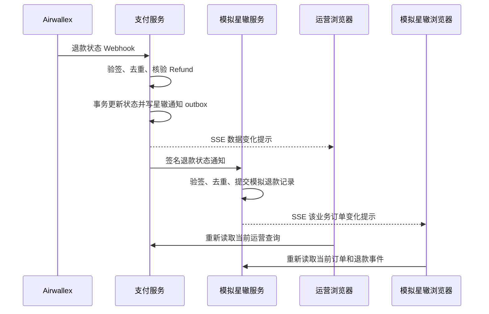

# 支付状态的浏览器实时更新

## 目标与当前问题

支付服务的交易状态可以由 Airwallex Webhook 更新，也可通过签名 HTTP 通知星辙服务。服务器端链路实时推进了数据库，但浏览器无法知道服务端记录已变化。关闭页面定时刷新后，页面必须手动重新读取。

本模块以服务器发送事件（SSE）通知已打开的运营后台和本地模拟星辙页面：数据变更后，浏览器只收到一个不含交易详情的提示，再调用原有查询接口读取最新结果。不使用浏览器定时轮询，不改变 Webhook、退款状态机、签名通知或业务审批边界。

## 时序

星辙批准退款指令本身仍由星辙服务端即时调用 `POST /api/v1/integration/refunds`。该指令更新支付服务后，也应提示运营浏览器刷新对应查询。Airwallex Webhook 和支付服务 outbox 的发送重试保持现状。

## 组件职责

- `ServerEventHub` 管理应用进程内 SSE 连接，支持运营全局频道和模拟星辙按业务订单订阅。
- `/api/v1/operations/events` 仅允许已登录运营账号连接；不发送金额、退款状态或任何凭证，只发送 `state-changed` 事件。
- `/mock-xingzhe/api/v1/orders/{businessOrderId}/events` 仅在 `local` 配置装配。事件按模拟业务订单隔离，只在该订单对应记录成功提交后发送。
- 两端前端在打开页面时仍执行一次正常查询；收到 SSE 事件或连接重新建立时，使当前活动查询失效并重新读取。保留手动刷新作为断线期间的兜底。
- SSE 发送须延后到数据库事务提交后执行，避免客户端读到旧快照。事件以触发重新读取为目的，不承担持久化、重放或资金状态判定。
- SSE 载荷仅为固定的 `refresh` 提示；模拟订单关联由服务端订阅主题隔离，不放进事件载荷。

## 连接、安全与恢复

- 运营事件流使用同源会话 Cookie 和已有 Spring Security 认证；浏览器不能传身份或角色覆盖服务端认证。
- 模拟器事件流只存在于 `local` profile；订阅前检查业务订单存在，且事件不包含其他订单数据。
- EventSource 断线后由浏览器自动重连。新连接建立后立即重新读取页面数据，弥补断线期间漏掉的通知。
- 连接关闭、超时或发送失败后从注册表移除，避免累积失效连接。
- 本地单实例由进程内连接表满足。未来若支付服务生产横向扩展，多实例之间需增加共享广播设施；当前不引入 Redis 或消息中间件。
- 保留 outbox 重试和 Webhook 事件持久化。SSE 只是浏览器展示提示，不是服务端可靠交付渠道；SSE 断开不影响退款状态或星辙通知。
- Webhook 接收后由已持久化事件处理器按短间隔领取待处理记录，星辙通知由 outbox 派发器按短间隔领取待发送记录。这些是服务器内部队列处理与失败重试，不会定时向 Airwallex 查询退款状态，也不是浏览器刷新状态；事件处理和通知派发存在数秒级调度延迟。

## 验证场景

1. 打开运营退款详情和模拟星辙对应订单，保持页面不手动操作。
2. 星辙批准退款后，支付服务记录出现在运营页面；Airwallex Webhook 推进到 `ACCEPTED` 后，两个页面均通过 SSE 提示自动重新读取。
3. 后续 `SETTLED` Webhook 更新结算阶段，星辙模拟记录和两个页面显示新状态，不重复触发退款业务副作用。
4. 暂停某个浏览器的 SSE 连接期间继续更新状态；恢复连接后页面重新读取并显示最新数据库状态。
5. 确认后端支付/退款状态补查开关保持关闭、前端没有定时刷新代码。

本地模拟通过不代表真实星辙部署具备 SSE 页面推送，也不代表真实星辙退款接口已确认。
