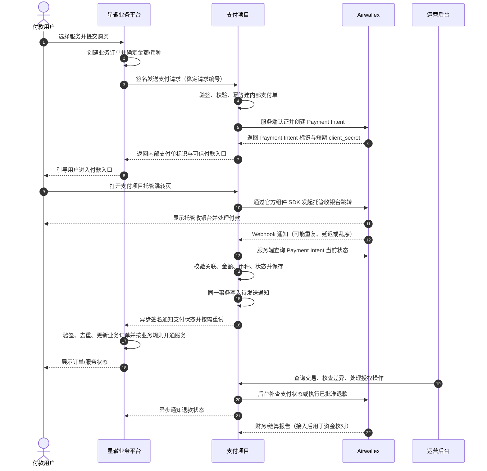

# 星辙支付接入方案说明（甲方评审稿）

## 1. 文档用途与阅读提示

本文用于与星辙（甲方）确认支付接入的整体方向、职责边界、各环节实现方式、异常处理和上线前置条件。它把当前产品说明、已形成的系统设计和 Airwallex 官方接口资料整合成一份业务可读的方案说明。

本文中的状态标记含义如下：

- **当前方案**：当前项目采用的方向，可供本次评审确认。
- **本地/沙盒已实现**：代码或开发环境已有对应能力；不代表星辙生产接口、Airwallex 生产账户或端到端生产交易已经验收。
- **待星辙确认**：依赖甲方业务规则、正式接口或生产资源，确认前不视为正式约定。
- **待 Airwallex 账户确认**：依赖星辙商户账户的审批、权限、国家/地区、币种或付款方式配置。

一句话概括：**星辙负责业务订单、退款审批和服务开通；支付项目负责把星辙订单安全地交给 Airwallex 收款、核实支付/退款结果并可靠回传；Airwallex 托管付款页面并提供支付处理与资金记录。**

> 评审边界：本稿是方案评审材料，不替代星辙正式接口文档、Airwallex 账户开通确认、双方签署的业务规则或上线验收记录。代码中的星辙协议目前是本地联调契约和生产对接提议。

## 先用大白话理解这套方案

可以把支付项目理解成星辙和 Airwallex 之间的“收款协调员”：星辙把已经确定金额的订单交过来；支付项目去 Airwallex 创建这笔收款；付款人到 Airwallex 的页面完成付款；Airwallex 把核实结果告诉支付项目；支付项目再把结果可靠地转告星辙。星辙最后决定是否开通自己的服务。

最重要的是分清下面三件事：

1. **用户回到星辙页面，不等于付款成功。** 浏览器页面只是用户看到的页面，可能在付款通知之前返回，也可能网络中断。
2. **Airwallex 通知支付项目的结果，才是我们核实付款的起点。** 支付项目还会向 Airwallex 查询这笔付款，核对订单号、金额和币种。
3. **星辙收到付款结果后，仍由星辙更新订单和开通服务。** 支付项目不会替星辙决定服务是否开通。

### 一段可以直接拿来口头说明的话

> 用户在星辙下单后，星辙把订单号、金额和币种交给支付项目。支付项目在 Airwallex 建立对应的收款记录，再把用户带到 Airwallex 自己托管的付款页面完成付款。付款后，Airwallex 会通过后台通知告诉支付项目结果；支付项目再查询核实金额、币种和订单是否一致，然后把结果可靠地通知星辙。星辙收到后更新自己的订单并开通服务。通知失败会自动重试；退款由星辙审批，支付项目只负责按已批准的指令执行。支付、退款和真正结算到账会分别记录，不能混为一件事。

下面的技术名词可以先按这张表理解，不必先记住英文名称：

| 名词 | 大白话解释 | 在本方案中的作用 |
| --- | --- | --- |
| 接口 / API | 两个系统之间约定好的“收发消息通道” | 星辙把付款请求发给支付项目；支付项目把请求发给 Airwallex |
| Payment Intent（支付意图） | Airwallex 为某笔收款建立的一张“付款跟踪单” | 创建它只是准备收款，不代表用户已经付钱 |
| Hosted Payment Page（托管付款页） | Airwallex 提供并负责运行的付款网页 | 用户在这里选择可用方式并完成付款；本项目不收集银行卡资料 |
| SDK | Airwallex 提供的一段网页工具 | 帮助本项目把用户安全地带到 Airwallex 托管付款页 |
| Webhook（后台通知） | Airwallex 主动向支付项目发送的一条“有结果了”消息 | 告诉支付项目某笔付款可能发生变化；支付项目仍会再查询核实 |
| 页面返回 | 付款人浏览器从付款页回到星辙或支付项目页面 | 只影响用户看到的页面，不作为付款成功凭证 |
| 验签 / 签名 | 用双方事先保管的密钥检查消息是不是对方发的、内容有没有被改 | 防止伪造支付请求、通知或退款指令 |
| 幂等 / 防重复 | 同一条请求重复送达时，只按一件事处理 | 网络超时重试时避免重复建支付单或重复退款 |
| outbox（待发送通知箱） | 数据库里保存的“还没送达的通知清单” | 即使星辙暂时收不到，也能保留通知并继续重试 |
| 主动查询 / 补查 | 支付项目主动向 Airwallex 再问一次当前状态 | Webhook 延迟或未到时恢复状态；不会重新收款 |
| 对账 | 把不同系统里的记录逐笔比较，看是否一致 | 比较星辙订单、支付项目记录、Airwallex 交易和结算报告 |
| 结算 | Airwallex 按批次把交易资金记入账户余额，并扣除或另计费用 | 发生时间和金额口径都可能不同于用户付款时的订单金额 |
| 沙盒 | Airwallex 提供的模拟环境 | 用于开发联调；不代表生产账户已开通或真实资金已验收 |
| 令牌 / client_secret | 有时效或用途限制的访问凭证 | 临时允许付款页面继续完成托管跳转；不能替代服务端密钥 |

### 两种“IP 白名单”分别是什么

“IP 白名单”就是只允许指定的网络地址通过。Airwallex 对接中有两个方向，配置位置和填写的地址完全不同：

| 白名单位置 | 谁访问谁 | 应加入哪一方的地址 | 配错的结果 |
| --- | --- | --- | --- |
| Airwallex API Key 的 IP 白名单 | 支付项目服务器向外请求 Airwallex | 支付项目生产服务器固定的**出口 IP**。也就是 Airwallex 看到的支付项目服务器来源地址 | 支付项目从未登记的 IP 请求 Airwallex，会被拒绝，常见为 403 |
| 支付项目服务器/防火墙的 Webhook 来源 IP 白名单 | Airwallex 向内请求支付项目 | Airwallex 官方公布的、对应环境的 Webhook **发送 IP** | 防火墙可能挡住 Webhook，支付结果通知进不来 |

这不是把 Airwallex 的地址填进 API Key 白名单，也不是把本机电脑的 IP 当作生产服务器 IP。Airwallex API Key 白名单限制的是**使用这把密钥发起 API 请求的来源**；Webhook 来源白名单限制的是**谁可以访问本项目的通知入口**。即使设置了 Webhook 来源白名单，仍必须校验 Webhook 签名；IP 检查与签名验证是两道不同的安全检查。

开发联调时，临时隧道或家用网络的出口地址可能变化，通常没有可长期依赖的固定出口 IP；不要猜一个 IP 填入 API Key 白名单，否则合法请求也可能被挡。生产部署时由负责服务器/网络的一方提供固定出口 IP（常见做法是云服务器经固定公网地址/NAT 网关出网），再将它加入 API Key 白名单。若当前 Airwallex 界面让你填写 Webhook 白名单，应使用官方文档中**当前环境**的列表，并让运维在实际接收 Webhook 的防火墙/WAF/网关放行；沙盒和生产的地址不同，官方列表可能更新，按官方页面为准。

官方说明：[Airwallex API Key IP 白名单](https://www.airwallex.com/docs/developer-tools/api/ip-whitelisting)、[Webhook 监听与 Airwallex 发送地址](https://www.airwallex.com/docs/developer-tools/webhooks/listen-for-webhook-events)。

## 2. 各方负责什么

| 参与方 | 负责事项 | 不由其决定的事项 |
| --- | --- | --- |
| 星辙业务平台 | 用户、商品/服务、业务订单、订单金额与币种、退款申请及审批、支付成功后的服务开通；发起支付和已批准的退款指令；接收支付/退款结果 | Airwallex 实际支付事实由 Airwallex 记录；支付项目不替星辙审批退款或开通服务 |
| 支付项目 | 接收并校验星辙请求；建立星辙订单、内部支付单和 Airwallex 交易的关联；创建付款入口；核实支付/退款状态；可靠通知星辙；处理通知重试、异常记录、运营权限、审计和支付状态核查 | 不创建或管理星辙商品和业务订单；不收集银行卡资料；不把未核实交易改成成功；不决定退款是否应获批 |
| Airwallex | 提供商户账户 API、Payment Intent、托管收银台、支付状态查询、Webhook、退款及财务/结算报告 | 不决定星辙订单是否有效或服务是否开通 |
| 付款用户 | 在 Airwallex 托管页面选择该账户当前可用的付款方式并完成付款及必要验证 | 不修改订单金额，不选择收款商户账户 |

支付事实、业务结果和资金结算是三类不同事实：Airwallex 核实支付成功，不代表星辙业务服务已开通；星辙收到 HTTP 通知，不必然代表业务订单处理完成；支付成功也不代表资金已结算到可用余额或银行账户。

## 3. 整体链路

### 正常付款的逐步说明

1. **星辙创建业务订单。** 星辙确定业务订单编号、订单金额、币种，以及是否能提供付款人国家/地区。订单、价格和服务内容仍以星辙为准。
2. **星辙向支付项目发起支付。** 当前本地契约示例为 `POST /api/v1/integration/payment-orders`。支付请求带稳定的请求编号和业务订单编号。当前模拟协议使用双向系统中的入站 HMAC 签名；生产认证和请求字段待星辙正式接口确认。
3. **支付项目接单并防止重复。** 验证请求签名、时间窗口和随机数，校验金额/币种/字段；以请求编号和业务订单编号进行幂等控制。同一编号、同一内容重复提交返回已有支付单，不创建第二笔；同一编号内容不一致则拒绝。
4. **支付项目创建 Airwallex Payment Intent。** 后端使用服务端 Client ID 与 API Key 获取短期访问令牌，再调用 Airwallex `POST /api/v1/pa/payment_intents/create`。记录 Airwallex Payment Intent 标识及星辙业务订单、内部支付单的关联。创建成功只表示付款意图已建立，尚不表示用户已付款。
5. **星辙交付付款入口。** 支付项目返回受信任域名下的付款地址。星辙将用户引导到该入口，不能从浏览器传入任意跳转地址或改写订单金额。
6. **用户在 Airwallex 托管页面付款。** 支付项目的轻量页面通过 Airwallex 官方 Components SDK 将用户跳转至 Hosted Payment Page（HPP）。Airwallex 页面根据账户、订单币种和付款人地区显示可用选项，收集付款资料并完成所需验证。支付项目不建设自己的银行卡表单、不保存卡号。
7. **支付项目核实结果。** Airwallex 向支付项目 Webhook 地址发事件。支付项目先使用该 Webhook 订阅的密钥、时间戳和原始请求体验签，再按事件编号去重。随后服务端查询 Payment Intent 当前状态，并核对 Payment Intent 编号、业务订单关联、金额和币种。用户浏览器返回、前端显示文字或单个付款尝试失败事件都不能直接作为成功依据。
8. **支付项目可靠通知星辙。** 经核实的支付状态和待发送通知写入数据库事务及 outbox。后台任务异步发送带签名通知；网络失败或星辙返回非成功响应时按策略重试。支付状态与通知投递状态分别保存。
9. **星辙更新业务状态。** 星辙验签、按事件编号去重、核对业务订单和金额币种后更新订单，并按自己的业务规则开通服务。若需要确认服务确已开通，应由星辙回执或订单查询接口提供证据。
10. **持续补查与运营跟进。** Webhook 未到、通知失败或状态长期未决时，支付项目按原交易查询 Airwallex，不重复创建支付；运营人员可查看交易及核查历史、重试待投递通知并留存审计。

## 4. 各功能的具体实现

### 4.1 星辙支付请求接入

**做什么：** 将星辙已创建的业务订单转化为支付项目内部支付单，并返回可继续付款的入口。

**当前实现方向：** 请求需包含 `businessOrderId`、`requestId`、`amount`、`currency`，可带 `shopperCountryCode`。金额与币种由星辙给出；支付项目保存不可随意改写的订单快照。业务订单号、内部支付单号和 Airwallex Payment Intent 号分别保存，不互相替代。

**关键处理：** 原始请求验签后再解析；重复请求使用原请求编号恢复既有结果；若金额、币种等内容被改动则报冲突；建单失败时保留原业务订单，让星辙以原请求编号重试。

**待星辙确认：** 正式地址、请求字段/类型、签名或其他鉴权方式、订单号唯一范围、重复支付规则、订单取消/过期及金额变更规则、错误码和超时重试约定。

### 4.2 Airwallex 认证和创建支付

**具体连接方式：**

1. 生产和沙盒分别配置各自的 Client ID、API Key 和 API 根地址，不能跨环境混用。
2. 后端调用 `POST /api/v1/authentication/login`，使用 `x-client-id`、`x-api-key` 换取短期 Bearer Token，并按过期时间复用。
3. 后端以 `Authorization: Bearer ...` 调用创建 Payment Intent API，传入订单金额、币种、星辙业务订单引用 `merchant_order_id` 和稳定的 `request_id`；返回的 Payment Intent 标识和相关快照落库。
4. Client ID、API Key、Bearer Token、Webhook 密钥只存在服务端或密钥管理配置中，不放浏览器、代码仓库或日志。

#### 创建 Client ID / API Key 时的权限建议

Airwallex 的 **Client ID 用来标识这把 API Key；API Key 是服务端调用 Airwallex 的秘密凭证**。创建密钥时选的“权限/范围”决定这把钥匙能访问哪些 Airwallex 功能。应按实际要用的功能开最小范围，不要为了省事选可访问全部功能的管理员密钥。

| 创建时的选项 | 本项目建议 | 原因与边界 |
| --- | --- | --- |
| 密钥类型 | 选择可限定资源权限的 scoped API key（受限 API Key），不新建全权限管理员 API Key | 能只开放本项目需要的功能；Airwallex 也建议生产集成使用受限密钥 |
| 权限层级 | 选择星辙实际收款的**账户级**权限，并只关联该商户账户 | 本项目操作的是星辙商户账户下的支付，不需要组织级管理权限或其他账户 |
| Payment Acceptance / Payments（收款） | 选择 **Write（读写）** | 创建 Payment Intent 和发起退款需要写权限；Airwallex 的 Write 范围同时包含该资源的读取能力，因此也覆盖本项目查询支付/退款状态。此权限还可能允许其他收款写操作，创建后应在权限清单中复核 |
| Finance → Financial Reports（财务报表） | **当前先不选**；将来启用报表 API 自动拉取时，再按“只读取现有报告”或“创建并读取报告”的实际方式选择 Read 或 Write | 当前项目尚未接入 Airwallex 财务/结算报告。提前开放会增加不需要的访问范围 |
| 其他资源 | 关闭 | 当前链路不需要转账、钱包资金移动、发卡、客户管理等无关权限 |
| API Key IP 白名单 | 本地/沙盒联调阶段按环境需要设置；生产在固定出口 IP 明确后加入 | 该地址是支付项目服务器向 Airwallex 发请求时的来源地址，不是 Webhook 的发送 IP |

Airwallex 当前把 Payment Intent、退款等接口归在 Payment Acceptance 资源范围；具体控制台名称可能随账户界面调整。写权限比较宽，若 Airwallex 账户支持更细粒度的子权限，应只开放“创建/读取 Payment Intent、创建/读取 Refund”所需项。选项和授权范围应由星辙账户管理员与技术负责人一同核对，不能只凭界面名称推断权限大小。

#### 创建 Webhook 订阅时的事件和设置建议

Webhook 订阅不是再创建一把 API Key。创建订阅时选的**事件**表示“哪些变化发生时 Airwallex 要通知我们”；它与上面的 API Key 权限不同。受限 API Key 的权限范围也会影响该账户允许订阅哪些 Webhook 事件。

当前项目接收并处理 `payment_intent.*` 类型的通知，然后按 Payment Intent 编号向 Airwallex 查询最新状态。因此建议：

1. 选择星辙正在使用的 Airwallex 账户和环境（沙盒/生产）。
2. 填写支付项目公开可访问的 HTTPS 通知地址；当前项目接收路径为 `/api/v1/webhooks/airwallex`。本地开发需使用可从公网访问的临时 HTTPS 隧道，不能填写 `localhost` 给 Airwallex 访问。
3. 事件只订阅本项目处理的 Payment Intent 状态变化。若控制台提供事件前缀筛选，可选 `payment_intent.*`；若要求逐条选择，按该账户当前 Webhook 版本勾选 Payment Intent 创建、待付款/待客户操作、处理中、成功、失败、取消和更新等状态事件，并在沙盒发事件验证。事件名称会随版本有差异，应以控制台预览的事件清单和所选 API 版本为准。
4. 当前退款状态通过支付项目服务端查询 Airwallex Refund 获取，**无需为了当前实现勾选 Airwallex `refund.*` Webhook 事件**。如果后续改成退款事件驱动，再单独评估、实现和验证。
5. 固定并记录 Webhook API 版本，避免字段/事件名称变动；为订阅设置独立 Webhook 密钥，安全交给支付项目服务端配置。
6. 保存订阅后确认对应接收服务器允许该环境的 Airwallex Webhook 发送 IP 访问，并确认服务会先验签、快速应答，再后台处理。Airwallex 对 Webhook 要求服务器返回 HTTP 200，否则会重试。

不要把所有产品线事件都勾上。当前处理器只接受 `payment_intent.*`；不需要订阅转账、发卡、账单等事件。付款尝试事件 `payment_attempt.*` 与整笔付款单状态不是一回事，当前代码不把它们作为付款单状态输入。

Airwallex 的创建 API 要求订单金额、币种、商户订单引用和请求编号。创建请求超时后必须用相同的服务商幂等编号恢复或查询，不能换新编号盲目再建一笔。

### 4.3 托管收银台与付款入口

**当前方案：** Payment Intent + Airwallex.js Components SDK + Hosted Payment Page。付款入口短暂读取受控的付款上下文，再以必要的 `client_secret` 和币种调用官方 `redirectToCheckout`，将用户转到 Airwallex 托管页面。页面只承担衔接职责，不承载自有支付方式选择、银行卡输入或交易结果裁定。

**为什么这样选：** Airwallex 托管页面负责付款资料处理和支付流程，支付项目不接触卡资料；同时保留已实现的 Payment Intent 建单、Webhook 核实和退款关联流程。Airwallex 另有 Checkout Session 托管流程，但官方文档标注该能力为 Early Access；切换会改变创建付款和接收跳转地址的集成方式，需先核实星辙账户是否可用并评估后再决定。

**页面返回规则：** 浏览器返回地址由服务端可信配置提供，不能相信客户端任意 URL。返回页面只查询支付项目当前状态、展示状态和返回星辙订单入口；不依据浏览器查询参数或用户到达成功页就写支付成功。当前 HPP 方案的通用取消返回行为及星辙订单返回页需双方确认。

### 4.4 Webhook、主动查询与状态归一

**Webhook 接收：** Airwallex Webhook 使用独立订阅密钥。服务端按 `x-timestamp` 与原始 JSON 请求体计算 HMAC-SHA256，与 `x-signature` 比对，并检查时间窗口；验签应在 JSON 解析前进行。事件 `id` 用于去重。持久化事件任务后尽快返回 HTTP 200，再异步完成状态处理，避免超时导致不必要的重复投递。

**服务端核实：** Webhook 事件只是触发核实的信号。支付项目查询 `GET /api/v1/pa/payment_intents/{id}` 当前对象，对照外部交易编号、星辙业务订单号、金额、币种及服务商状态，再归一为本项目状态。状态不认识、关键字段不一致或查询失败时保留待核实/异常状态，不通知支付成功。

**自动补查：** 对已有 Airwallex 交易编号、长期处于未决状态的支付单，后台任务定期查询；使用数据库租约和频率限制避免多实例重复查询。单笔失败延后重试，不阻塞其他交易；终态停止定期扫描。创建请求尚无服务商编号时，按原幂等请求恢复，补查任务不另建支付。

**支付状态与通知状态分开：** 例如支付已成功但星辙暂不可达时，内部支付仍是成功，通知单独处于待重试。不能为了通知失败把支付改回失败，也不能把 HTTP 已送达误作星辙业务已完成。

### 4.5 支付结果通知星辙

**当前方式：** 后端把支付状态变化及通知 outbox 写在同一事务中，避免状态已更新但通知任务丢失。分发器读取待发送事件，使用支付项目到星辙方向的独立密钥签名，请求星辙 HTTPS 接口；网络错误或非成功响应进入重试。事件含唯一 `eventId`、业务订单号、支付单号、状态、金额、币种和发生时间。

**星辙接收建议：** 星辙先验签，再按 `eventId` 去重，核对业务订单、金额与币种，然后更新订单。支付成功后由星辙决定并执行服务开通。正式通知响应定义、回执/订单查询及重复/乱序事件规则须甲方确认。

**交付状态应分层展示：** 支付已核实、通知已被接口接收、星辙业务已更新/服务已开通，分别跟踪。后两项若需确认，需要星辙回执或查询能力。

### 4.6 退款指令接收与执行

**业务边界：** 用户退款申请、退款审批、部分退款策略和退款资格都由星辙负责。支付项目只接收星辙已批准的退款指令。

**执行步骤：**

1. 星辙发送唯一 `refundRequestId`、业务订单号、支付单号、金额、币种和退款原因；使用独立退款入站凭证/签名。
2. 支付项目去重并核实原支付已成功，核对订单、币种和金额；计算已执行及处理中退款预留额，避免超过已核实的支付金额。
3. 不匹配或证据不足的指令记录为拦截/待核实并通知星辙；通过校验后先保存为“待员工管理员确认”。
4. 具有 `STAFF_ADMIN` 权限的员工管理员再次核对后确认；支付项目用服务端稳定的退款 `request_id` 调用 Airwallex `POST /api/v1/pa/refunds/create`。
5. 保存 Airwallex 退款编号和原始状态，后续按退款编号或原请求编号查询恢复；网络超时等未知结果保持额度预留，不换新请求编号再次退款。
6. 退款状态变化写入通知 outbox，异步签名通知星辙。退款请求受理、服务商接受、进入结算报告和实际到账不能合并成“退款完成”。

**权限边界：** 员工操作员可按授权查看和跟进；员工管理员才能执行退款确认；项目所有者只读。任何角色都不能手工把退款状态改为成功。

**待星辙确认：** 正式退款指令时点、审批证据、全额/部分退款与多次退款规则、指令编号、失败/超时语义、是否接受支付侧管理员二次确认及正式回执。

### 4.7 运营后台、权限与审计

运营后台用于星辙授权员工查询和处理支付运行问题，而非代替星辙业务后台。当前实现范围包括资金事实总览、交易查询、退款记录、支付状态核查、通知状态与重试、员工账号邀请/角色控制和操作审计。

资金总览区分币种和日期范围，展示支付成功金额、退款处理情况及异常计数。只读所有者可查看交易与操作记录，但无支付、退款、通知重试、备注或状态处理权限；员工账号按角色开放需要的操作。手工“改成支付成功”不属于运营能力。

正式账号来源、甲方员工邀请责任、角色名称/权限、数据留存期限、告警对象和报表字段仍待星辙确认。运营功能的存在不等于甲方已验收实际页面或权限流程。

### 4.8 支付状态核查与资金结算对账

当前逐笔核查可由后台任务或授权员工触发，服务端查询 Airwallex Payment Intent，将本地支付快照与远端编号、金额、币种及状态比较，并保存每次检查时间、结果和差异原因。核查记录是证据，不直接改写交易状态，不会自动退款。

**结算另成一层：** Airwallex Payment Intent 表示某笔付款的支付状态，不证明该笔资金已进入结算批次。正式资金对账需取得生产报告权限和星辙订单/退款账本，通过 Settlement Report、Transaction Reconciliation Report、Balance Activity 等报告，按交易、退款、费用、汇兑、结算批次和净额匹配。

当前项目未接入 Airwallex 财务/结算报告，也没有星辙正式订单查询/处理回执。因此当前展示的是支付状态核查和支付/退款事实，不是完整资金结算对账；结算净额与订单金额不能直接比较。

### 4.9 本地模拟与生产隔离

开发阶段有本地模拟星辙订单系统，以及两种支付结果联调路径：Airwallex 沙盒托管收银台；或不请求 Airwallex 的本地结果模拟，用于验证本项目状态、通知与星辙接收流程。模拟交易具有独立来源标记，不进入生产资金统计、不参与 Airwallex 查询/退款/结算核对。

生产环境只部署支付项目，不启用模拟星辙页面和本地结果模拟接口；沙盒与生产分别使用域名、API 凭证、Webhook 配置和密钥。产品后台不向星辙员工或付款用户提供测试付款或模拟交易入口。

## 5. Airwallex 官方资料与本方案的对应关系

| 本方案环节 | 官方资料 | 用途 |
| --- | --- | --- |
| 服务端认证 | [API Access Token](https://www.airwallex.com/docs/api/authentication/api_access_token)、[Manage API keys](https://www.airwallex.com/docs/developer-tools/api/manage-api-keys) | Client ID/API Key 换短期访问令牌；令牌复用；密钥作用域及保护 |
| 创建与查询支付 | [Create Payment Intent](https://www.airwallex.com/docs/api/payments/payment_intents/create)、[Payment Intents API](https://www.airwallex.com/docs/api/payments/payment_intents/api)、[Payment Intent 快速接入](https://www.airwallex.com/docs/payments/get-started/using-payments-intent-api) | `amount`、`currency`、`merchant_order_id`、`request_id`、创建后查询和幂等恢复 |
| 托管付款页 | [Hosted Payment Page SDK](https://www.airwallex.com/docs/js/payments/hosted-payment-page)、[Use a pre-built payment page](https://www.airwallex.com/docs/payments/integration-options/web-checkout/hosted-payment-page) | `redirectToCheckout`、client secret 与币种、Airwallex 托管付款资料处理 |
| Webhook | [Listen for webhook events](https://www.airwallex.com/docs/developer-tools/webhooks/listen-for-webhook-events)、[Webhooks overview](https://www.airwallex.com/docs/developer-tools/webhooks/webhooks-overview) | Webhook 订阅、API 版本、事件编号、签名、原始请求体验签、200 应答与重投 |
| API Key 权限和来源 IP | [API key scopes](https://www.airwallex.com/docs/developer-tools/api/api-key-scopes)、[Manage API keys](https://www.airwallex.com/docs/developer-tools/api/manage-api-keys)、[IP whitelisting](https://www.airwallex.com/docs/developer-tools/api/ip-whitelisting) | 账户级/组织级访问、资源读写范围、限制调用 API Key 的服务器 IP |
| Webhook 来源 IP | [Listen for webhook events](https://www.airwallex.com/docs/developer-tools/webhooks/listen-for-webhook-events) | Airwallex 向支付项目发送通知时使用的环境对应 IP 地址；应在接收端网络规则中放行 |
| 退款 | [Refunds](https://www.airwallex.com/docs/payments/manage-payments/refunds)、[Refunds API](https://www.airwallex.com/docs/api/payments/refunds) | 退款创建、状态含义、退款事件和按稳定请求编号恢复 |
| 账户可用能力 | [Payment Method Types API](https://www.airwallex.com/docs/api/payments/config/payment_method_types)、[Sandbox environment](https://www.airwallex.com/docs/developer-tools/sandbox-environment) | 沙盒联调及按账户/订单条件查询可用方式；不能仅凭接口存在推断账户已开通 |
| 资金报表与结算 | [Financial Reports API](https://www.airwallex.com/docs/api/finance/financial_reports)、[Reporting for settlements](https://www.airwallex.com/docs/payments/about-airwallex-payments/settle-into-your-airwallex-balance)、[Financial reports overview](https://www.airwallex.com/docs/global-treasury/reporting/financial-reports) | 生成/取得财务报告，理解结算批次、余额活动和交易核对报告的区别 |

**账户能力说明：** 以上资料解释 Airwallex API 如何使用，不代表星辙账户已获相应权限。实际 API 范围、币种、付款方式、退款资格、结算模式和报表权限都应由星辙在沙盒及生产账户分别确认。

## 6. 状态与异常处理原则

| 场景 | 处理方式 |
| --- | --- |
| 星辙重复发送相同支付请求 | 依稳定请求编号返回同一支付单和入口，不重复建单 |
| 创建 Payment Intent 超时 | 保留原请求关系，以原服务商幂等编号恢复/查询；不盲目创建第二笔 |
| 用户完成付款后浏览器返回，但 Webhook 尚未到 | 页面仍显示处理中/待核实；等待 Webhook 或由后台查询，不根据浏览器信息判成功 |
| Webhook 重复、延迟或乱序 | 按事件编号去重，查询 Payment Intent 当前状态；不按到达先后直接覆盖最新事实 |
| 支付成功但通知星辙暂时失败 | 支付仍保持已核实成功，outbox 重试同一业务事件；不得重新收费 |
| 金额、币种、业务订单或 Airwallex 标识不一致 | 保留差异并进入待核实，不通知成功，不由员工直接修成成功 |
| 退款指令重复 | 相同退款编号及相同内容返回原退款记录；编号相同但内容不同拒绝 |
| Airwallex 退款请求超时 | 保留退款额度并按原 `request_id` 查询恢复，不以新编号再次退款 |
| 星辙接口返回成功但服务未开通 | 通知送达与星辙业务完成分开；需星辙回执或订单查询接口核对 |
| 支付成功但结算报告尚未生成 | 支付记录仍可核实；结算状态保持待报告/待核对，不能估算或宣称到账 |

## 7. 当前完成情况与未完成边界

| 能力 | 当前情况 | 对甲方的表述边界 |
| --- | --- | --- |
| 星辙到支付项目支付请求、签名及幂等 | 已有本地模拟契约和代码 | 真实星辙生产字段、认证、地址和响应待确认/适配 |
| Airwallex 服务端认证与 Payment Intent 创建/查询 | 已用沙盒凭据完成建单及查询相关本地核验 | 不代表生产凭证、正式账户权限或付款成功验收 |
| Airwallex 托管页面跳转 | 已按官方 SDK 托管跳转实现 | 实际浏览器付款流程、Webhook 到达与星辙开通尚待完整人工联调 |
| Webhook 验签、事件去重和服务端状态核实 | 已有实现 | 事件版本、正式账户配置和全链路沙盒事件仍需确认/验收 |
| 星辙支付通知 outbox 与重试 | 已有本地模拟链路 | 真实通知地址、签名规范、回执和业务订单结果待星辙提供 |
| 退款指令拦截、管理员确认、Airwallex 调用和状态恢复 | 已有实现 | 星辙正式退款契约、账户退款能力及沙盒/生产退款验收未完成 |
| 运营权限、审计、资金事实总览、支付状态核查 | 已有初版模块和实现 | 甲方角色矩阵、页面验收和真实数据口径待确认 |
| 完整结算/资金对账 | 尚未接入 Airwallex 结算报告与星辙业务账本 | 目前不能称为完成资金结算对账或确认银行到账 |
| 生产部署与真实星辙端到端验收 | 待开始/待外部资料 | 需生产资源、账户能力、正式契约和双方验收 |

状态以项目文档截至 2026-10-10 的记录为准；新的沙盒或生产验收结果应更新本表及对应架构文档。

## 8. 建议本次与甲方确认的事项

### A. 先确认整体方向

1. 是否确认星辙继续负责业务订单、退款审批和服务开通，支付项目只做支付通道、核实、执行已批准退款、通知及留痕？
2. 是否确认付款资料由 Airwallex Hosted Payment Page 托管，支付项目不建设自有银行卡表单、不采集或保存卡资料？
3. 星辙是否持有并管理用于本项目的 Airwallex 商户账户？正式对接是否使用星辙自己的账户凭证和主体？
4. 首期是否只支持单次订单付款，人民币/美元作为目标币种，并以商户账户实际可用能力为准？

### B. 确认支付接口和业务规则

5. 星辙可提供哪一套正式支付发起接口、接口认证方式、业务订单编号、金额精度和币种字段？
6. 同一业务订单是否只允许一笔支付？哪些条件可重新支付；取消、过期、改价和超时订单如何处理？
7. 星辙是否能提供付款人国家/地区？字段表达付款人所在地区还是其他含义？缺省时由 Airwallex 账户/订单配置处理，还是按业务规则补充？不能由币种自动推断。
8. 星辙收到支付通知后，以什么回执或订单查询结果作为“业务订单已更新/服务已开通”的最终确认？
9. 对通知重复、延迟、乱序，星辙采用什么幂等编号/版本或更新时间规则？

### C. 确认退款、运营和对账

10. 星辙批准退款后通过什么接口发送指令？退款编号如何生成？首期支持全额、部分和多次退款吗？
11. “星辙审批后，支付侧管理员二次确认再调用 Airwallex”是否符合甲方的风险控制和日常流程？谁担任管理员？
12. 星辙员工账号由谁邀请和停用？员工管理员、操作员、只读所有者各自需要查看和执行哪些操作？
13. 通知失败、长时间待核实、退款拦截和对账差异分别通知谁、通过什么渠道、期望多快响应？
14. 资金对账以 Airwallex 哪类报表为准，星辙提供何种订单/退款账本？对账周期、金额/手续费/汇兑容差和差异处理责任如何划分？

### D. 确认上线资源与验收范围

15. 星辙提供哪些沙盒/生产账户权限、Webhook 配置人员和账户能力确认？哪些币种、地区和付款方式要纳入首轮验收？
16. 生产域名、HTTPS、部署区域、网络访问、密钥保管/轮换、数据库备份、监控告警和运维责任分别由谁负责？
17. 双方是否按“订单创建与重试、托管付款、支付状态核实、通知失败恢复、退款执行、支付核查、结算报告匹配”分段验收，并为每项定义成功证据？

## 9. 建议的推进顺序

1. **确认业务边界和关键决策。** 先确定 Hosted Payment Page、单次付款、订单唯一对应、退款责任及运营权限等方向。
2. **取得正式接口资料。** 星辙提供付款/退款请求、通知回执、订单查询、认证、错误码、幂等与状态规则；支付项目把提议契约调整成正式适配契约。
3. **核实 Airwallex 账户能力。** 确认账户主体、沙盒/生产环境、API key scope、币种、付款方式、退款能力、Webhook 版本和财务报表权限。
4. **完成端到端沙盒联调。** 覆盖支付成功、拒绝/处理中、Webhook 重复或延迟、星辙通知失败后恢复、退款成功/失败/超时和退款通知恢复。
5. **接入真实对账来源并验收运营流程。** 匹配星辙业务订单、支付项目交易、Airwallex 交易/退款/结算报告，确认角色、告警、审计和差异处理。
6. **生产准备及双方签字验收。** 按独立生产凭证和资源部署，确认密钥、备份、监控、回滚、支持责任和上线观察期；沙盒结果不能替代生产验收。

## 10. 项目内参考资料

- [产品范围与职责基线](./product-spec.md)
- [支付创建、托管跳转、结果核实与通知实现](../architecture/payment/payment-flow.md)
- [星辙与 Airwallex 接口字段、签名、幂等与状态约定](../architecture/integration/payment-interface-contracts.md)
- [星辙付款及退款指令契约（提议/本地模拟）](../architecture/integration/xingzhe-payment-contract.md)
- [星辙批准退款的执行与核实](../architecture/refund/refund-execution.md)
- [支付状态核查与结算对账边界](../architecture/reconciliation/payment-status-check.md)
- [运营后台与权限](../architecture/operations/operations-console.md)
- [资金总览口径](../architecture/operations/finance-overview.md)
- [生产部署与资源准备](../operations/deployment.md)
- [项目技术栈与已确认选择](../engineering/technology-stack.md)

以上项目内文档用于说明当前实现/设计来源；其中涉及星辙接口的内容仍可能标记为提议或待确认，不能直接视为甲方正式接口承诺。
