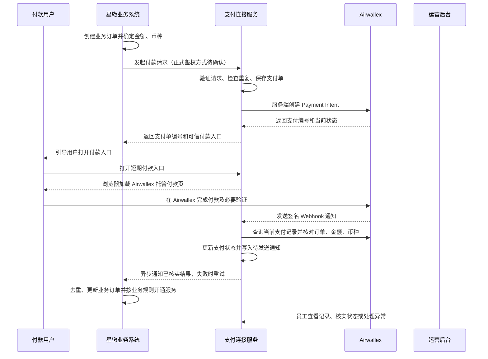

# 星辙与 Airwallex 支付连接方案说明

## 文档用途

这份说明用于和星辙讨论本项目的职责、当前模拟链路、实现方式，以及正式接入需要星辙提供和确认的资料。它既是一份沟通材料，也是一份当前实现说明。

**重要边界：**目前没有取得星辙正式接口文档。文中涉及星辙的地址、字段、签名、状态和错误处理，凡标为“本地模拟”或“建议契约”的内容，都不能视为星辙现行协议。正式对接前必须以星辙提供的接口资料和双方确认结果为准。

## 1. 先用一句话介绍项目

> 本项目是星辙业务系统与 Airwallex 之间的支付连接服务。星辙继续创建业务订单、确定金额并管理自己的业务；本项目把星辙的付款请求转换为 Airwallex 收款请求，将用户引导至 Airwallex 托管付款页，核实支付结果后再通知星辙。银行集。本项目不替星辙管理用户、商品、业务卡等付款资料由 Airwallex 收审批或服务开通。

### 项目做什么

- 接收星辙发来的付款请求，建立星辙业务订单、本项目支付单和 Airwallex 支付记录之间的关联。
- 使用星辙持有的 Airwallex 商户账户，在服务端发起收款。
- 把用户带到 Airwallex 托管付款页；付款资料不经过本项目的自有表单。
- 通过 Airwallex 服务端通知和服务端查询核实结果，再把可信结果通知星辙。
- 保存支付、退款、通知、核查和员工操作记录，支持运营排查。
- 在星辙已批准退款后，按约定接收退款指令并执行支付侧核验与操作。

### 项目不做什么

- 不创建或维护正式的星辙业务订单、商品、用户资料和服务权限。
- 不决定订单金额、币种、用户是否符合购买条件或是否应该开通服务。
- 不代替星辙审批退款。
- 不收集、保存或处理用户的银行卡号、验证码、钱包密码等付款资料。
- 不把浏览器显示的成功页面当成支付成功证明。
- 不将本地模拟付款、沙盒交易或模拟星辙页面交付为生产功能。

### 谁对哪类状态负责

| 信息或决定 | 权威负责方 | 本项目的作用 |
| --- | --- | --- |
| 业务订单、用户、商品、订单金额与币种 | 星辙 | 接收必要的支付字段并保存快照 |
| Airwallex 支付、支付尝试和退款的实际状态 | Airwallex | 查询和核对服务商记录 |
| 本项目支付单、接口通知和处理记录 | 本项目 | 建立关联并留痕 |
| 星辙业务订单是否更新、服务是否开通 | 星辙 | 发送已核实结果；需要星辙回执或订单查询来确认 |
| 资金是否结算、手续费和净到账 | Airwallex 结算报告及星辙财务核对 | 当前结算报告尚未接入，不能由支付成功金额推算 |

## 2. 一张图看完整支付链路



用户从 Airwallex 返回星辙页面只是用户体验流程。支付服务必须依据 Airwallex 的可信服务端状态核实结果，不能依赖用户浏览器的返回动作。

## 3. 当前演示里实际发生了什么

当前仓库把两类程序分开：

| 程序 | 用途 | 是否属于生产交付 |
| --- | --- | --- |
| 支付服务后端 | 收款请求、支付记录、Airwallex 适配、通知、退款、核查和权限校验 | 是目标交付的一部分 |
| 支付运营后台 | 查看交易、退款、通知、核查、员工权限和审计 | 是目标交付的一部分，正式人员和权限来源待星辙确认 |
| 本地模拟星辙页面 | 模拟服务选购、业务订单、付款发起、订单历史及退款指令 | 否，仅开发联调用 |
| PostgreSQL 数据库 | 保存支付服务记录；本地配置也保存模拟星辙示例订单 | 数据库方案已用于当前开发，生产托管方式待确认 |

本地购买流程可以选择 Airwallex 沙盒或本地结果模拟器：

- **Airwallex 沙盒**：支付服务真实请求 Airwallex 沙盒创建 Payment Intent，再用托管页面完成付款人操作。沙盒账户不代表生产账户已经开通相同能力。
- **本地结果模拟器**：不经过付款页面，用于演示成功、失败、处理中和等待超时等状态如何写入支付服务并通知模拟星辙。它不是 Airwallex 交易，不能进入生产，也不能算真实收款验收。

模拟星辙的服务、订单、事件和“服务开通”只演示两套系统之间应如何传递信息。它不证明星辙真实业务接口已经接通。

## 4. 按步骤说明实现细节

### 第一步：星辙决定订单内容

正式流程中，星辙后端先创建自己的业务订单，并决定订单号、金额、币种和订单状态。浏览器不能自行决定金额，也不能选择收款商户账户。

当前本地契约示例使用 `businessOrderId` 表示星辙业务订单号、`requestId` 表示本次付款请求编号；金额使用十进制字符串，币种使用标准币种代码。付款人国家或地区 `shopperCountryCode` 是独立的可选信息，不能从币种推断。以上字段名和约束均待星辙确认。

### 第二步：请求进入支付服务

当前代码的提议入口为 `POST /api/v1/integration/payment-orders`。支付服务在业务处理前验证请求签名、时间窗口和随机数，再检查必填字段、金额精度、币种及同一请求是否重复。

通过后保存一条内部支付单，并保存星辙订单号、请求编号、金额、币种和可选付款地区的快照。相同的 `requestId` 重试时复用已有支付单；如果同一编号被用于不同金额或币种，不能当成正常重试。

### 第三步：支付服务向 Airwallex 创建收款

支付服务使用只保存在服务端的 Airwallex `Client ID` 和 `API Key` 获取短期访问令牌，再调用 Payment Intent 创建接口。接口请求中带上金额、币种、星辙业务订单号和稳定请求编号，响应的 Payment Intent 编号保存到内部支付单。

访问密钥不会发给浏览器。若服务商请求失败或超时，系统要保留当前结果并使用同一请求编号恢复或核实，不能随意新建一笔收款来掩盖未知结果。

### 第四步：把用户带到 Airwallex 托管付款页

支付服务返回一个受信任域名下的付款入口。浏览器用短期入口令牌读取本次支付所需的上下文，然后由 Airwallex 官方网页组件跳转到托管付款页。付款资料由 Airwallex 页面处理。

当前代码还会从服务端读取付款上下文，并短暂提供 Airwallex 要求的 `client_secret`。它和长期的 `API Key` 不是一回事：`client_secret` 只用于对应的一笔支付上下文，不应记录到日志或长期保存。付款入口令牌与返回状态令牌分开，返回令牌不能读取付款上下文。

### 第五步：Airwallex 通知支付服务

Airwallex 支付结果通过 Webhook，也就是服务商向支付服务发送的服务器间通知，送达 `POST /api/v1/webhooks/airwallex`。支付服务对原始请求内容和签名头做验签，通过后只保存必要的事件编号、事件类型及支付/退款对象编号，并快速回复接收结果。

后续处理按事件中的对象编号向 Airwallex 查询最新记录，核对支付编号、业务订单号、金额和币种。事件文本本身只用来触发核实；真正用于更新状态的是查询到并匹配成功的服务商记录。重复事件按 Airwallex 事件编号去重。

当前付款结果还可以由员工在运营后台触发即时核实；定时补查开关目前默认关闭。实际付款和沙盒 Webhook 的端到端送达情况，应单独按环境验收。

### 第六步：支付服务把结果可靠地通知星辙

只有经服务端核实的状态才能更新内部支付单。支付状态变化与待发送的星辙通知在同一数据库事务中记录到通知队列。后台投递器从队列取出通知，按约定签名发送；网络失败或星辙未返回成功响应时，记录失败并按退避间隔重试。

当前本地模拟通知使用事件编号去重。模拟星辙只在收到可信的 `SUCCEEDED` 支付状态后模拟开通服务。生产情况下，星辙仍需实现自己的去重和幂等更新，并决定业务订单及服务如何变化。

“支付服务已收到 Airwallex 通知”“支付服务已把通知发到星辙”“星辙已更新业务订单”“用户已获得服务”是四件不同的事，需要分别核对。

### 第七步：返回页面和状态查看

用户从 Airwallex 返回后，支付服务结果页可读取当前状态并触发一次有频率限制的服务端核实，再跳回星辙可信订单地址。浏览器回跳只负责衔接页面，不负责证明付款成功。用户看到“处理中”时，星辙应继续查询订单或等待可信通知，避免重复付款或提前开通服务。

### 第八步：退款、运营和核查

星辙负责退款申请和业务审批。本项目只处理星辙已批准的退款指令：验签、核对原支付单和金额、预留可退金额，再由有权限的运营管理员确认后调用 Airwallex。执行结果还要查询核实并通知星辙；状态未知时保留待核实记录，不能把未知当成失败并重复退款。

运营后台提供交易和退款查看、支付状态即时核实、失败通知重试、退款确认、异常备注、员工权限和审计记录。差异核查会保存本项目和 Airwallex 支付记录的比对结果。当前结算报告尚未接入，因此到账金额和手续费不应估算。

## 5. 关键术语，用日常语言理解

| 术语 | 直白解释 | 在当前项目里的作用 |
| --- | --- | --- |
| 支付单 | 支付项目内部的一张“跟踪卡”，记录这次支付关联了哪些订单和服务商编号 | 关联星辙订单、本项目支付编号和 Airwallex Payment Intent |
| Payment Intent | Airwallex 侧的一笔收款意图/记录 | 创建后用于托管收银台、查询和关联支付结果；创建成功不等于收款成功 |
| 托管付款页 | 由 Airwallex 提供和处理付款资料的页面 | 用户在该页面选择可用方式并完成支付，本项目不做银行卡表单 |
| Webhook | 服务商主动发给本项目服务器的状态通知 | 提醒本项目去查询并核实服务商当前状态 |
| 签名 | 请求内容的校验码，用来检查请求是否来自持有共享密钥的一方，以及内容是否被改动 | 保护星辙与支付服务接口，也保护 Airwallex 通知入口 |
| 时间戳 | 请求生成的时间 | 拒绝过旧请求，缩小攻击者重放旧请求的机会 |
| 随机数 | 每次请求都不同的一次性编号 | 配合已使用记录，阻止同一份旧请求被原样重复发送 |
| 幂等 | 同一业务请求重复送达时，只产生一次业务效果 | 防止网络重试创建多笔支付或多次开通服务 |
| Outbox 通知队列 | 与业务状态一起保存的“待发送通知清单” | 支付状态已保存但通知网络失败时，仍可继续重试 |
| 对账/核查 | 把两边的记录按编号和金额逐项比对 | 找出支付记录或通知是否不一致；不自动改动资金状态 |
| 结算 | 服务商按规则处理款项并形成结算记录 | 晚于用户付款；支付成功不代表资金已到银行账户 |

### 当前模拟签名是怎么回事

签名可以理解为双方共用一把不交给浏览器的“密钥”，发送方用密钥和请求内容算出一个校验码，接收方用同一密钥重新计算；两个校验码相同，才继续处理。密钥本身不会随请求传输。

当前本地星辙模拟契约约定：

1. 请求包含秒级时间戳、一次性随机数和原始 JSON 正文。
2. 本地代码把“时间戳、换行、随机数、换行、原始正文”连起来，以 HMAC-SHA256 和共享密钥计算校验码。
3. 接收方检查时间戳是否在五分钟窗口内，验证校验码，并把随机数记录十分钟以拒绝重复使用。
4. 支付请求、退款指令和支付服务发出的结果通知使用各自独立密钥；密钥只放服务端安全配置。

这是一套当前代码中的模拟规则，**不是星辙已要求或已确认的签名算法**。正式对接时，星辙可能要求不同的算法、字段排序、证书、密钥轮换、时间单位、网络白名单或请求头。双方应以星辙正式文档为准共同验证，不能只因为本地验签通过就认为生产安全接入完成。

### Airwallex 通知验签与星辙接口验签是两套事

星辙到支付服务、支付服务到星辙的接口签名，和 Airwallex 到支付服务的 Webhook 签名由不同密钥、不同配置和不同请求来源保护。不能共用密钥，也不能用 IP 白名单替代签名验证。

当前实现的 Airwallex Webhook 验签使用原始请求正文、`x-timestamp` 和 Webhook 密钥计算 HMAC-SHA256；时间戳按毫秒解析并限制在五分钟窗口内，在解析事件 JSON 前先验签。生产配置中的 Webhook 密钥和验证规则仍须与 Airwallex 商户账户控制台及当前官方资料核对。

## 6. 当前实现状态与边界

| 能力 | 当前情况 | 不能据此声称 |
| --- | --- | --- |
| 本地模拟星辙创建业务订单并发起付款 | 已有独立本地模拟页面和服务端接口 | 星辙正式 API 已接通 |
| 星辙付款请求验签、支付单创建和重复请求处理 | 当前代码有本地提议契约及验签实现 | 星辙已认可字段、签名、超时和错误码 |
| Airwallex Payment Intent 创建与查询 | 已有 Airwallex 沙盒接入代码；项目记录的既有联调包含沙盒建单和查询 | 生产商户账户、生产币种和付款方式已验收 |
| 托管付款跳转 | 当前代码采用 Airwallex 官方网页组件托管跳转 | 付款页面、浏览器返回和真实付款已完成端到端验收 |
| Webhook 接收、验签、去重及服务端查询 | 已有实现；退款通知相关工作区改动也在当前源码中 | 星辙正式环境的网络、证书及 Airwallex 生产通知已验收 |
| 通知队列、签名投递及重试 | 已有实现和本地模拟消费方 | 星辙真实接收接口、回执及服务开通已验证 |
| 本地支付结果模拟 | 仅本地配置使用，模拟数据带独立来源 | 发生了真实 Airwallex 交易 |
| 运营后台、员工权限、审计和异常查看 | 有当前实现；星辙正式员工身份源待接入/确认 | 星辙现有员工账号与生产权限已经打通 |
| 退款指令、支付侧核验、Airwallex 执行及状态通知 | 当前工作区有实现；具体生产协议和账户能力待确认 | 星辙退款审批接口、Airwallex 生产退款及用户到账已经验收 |
| 支付状态差异核查 | 已有本地支付记录与 Airwallex 记录核查能力 | 星辙业务账本和本项目已完成三方对账 |
| 结算金额、手续费及净到账 | 尚未接入 Airwallex 结算报告 | 支付成功额减退款额等于结算到账 |

当前整体演示链路可以说明系统的设计和本地/沙盒部分的实现。真实星辙契约、生产账户、生产通知、星辙业务结果确认及结算报告仍需单独完成接入和验收。

## 7. 正式对接需要星辙提供或确认什么

### 第一批：接通付款所需

1. 星辙测试环境和正式环境的接口地址、网络访问要求、版本策略及服务责任人。
2. 星辙如何调用本项目付款创建接口：请求字段、金额单位/精度、币种、订单号、请求编号、付款人地区及可选字段。
3. 星辙接口采用的认证/签名方案：算法、签名原文、编码、时间戳单位和允许偏差、随机数/重放处理、密钥交换及轮换方式；是否还需要证书或 IP 白名单。
4. 星辙希望收到哪些支付状态通知、通知字段和错误响应；星辙如何返回接收成功，以及重复、乱序、延迟通知如何去重和处理。
5. 用户完成付款后应返回的星辙订单页地址模板，以及星辙确认服务开通的回执或业务订单查询接口。
6. 星辙业务规则：同一订单是否允许多次支付、失败后何时可重试、订单取消/过期/改价时如何处理、处理中多久升级人工处理。

### 第二批：接入退款和运营

1. 星辙退款批准后如何发送指令，如何证明已批准，退款编号如何生成和重试。
2. 是否支持部分退款、多次退款、并发退款及退款金额规则；谁负责确认退款指令和处理退款异常。
3. 星辙员工身份源、角色、权限、账号停用和审计要求；本项目运营账号应如何接入。
4. 支付成功、退款状态和通知失败的业务联系人、响应时限与升级方式。

### 第三批：上线和财务验收

1. 星辙持有的 Airwallex 商户主体、账户地区、沙盒/生产权限、启用币种和付款方式。
2. Webhook 的 HTTPS 域名、证书、网络策略、密钥保管与轮换负责人。
3. Airwallex 结算报告权限及字段、星辙财务账本、对账周期、手续费/汇兑/差异口径和处理责任人。
4. 生产部署区域、域名、数据库备份恢复、监控告警、密钥管理和日常值守负责人。

## 8. 建议双方按证据验收

| 场景 | 双方应确认的结果证据 |
| --- | --- |
| 星辙发起一笔付款 | 星辙订单号、请求编号、本项目支付单和 Airwallex Payment Intent 能对应；金额币种一致 |
| 重复发送相同请求 | 不产生重复支付单或重复收款；返回可追溯的既有结果 |
| 托管付款成功/失败/处理中 | 用户页面和服务端状态分开；最终状态来自 Airwallex 服务端查询或有效 Webhook |
| Webhook 重复、延迟或签名不正确 | 重复事件不重复产生业务效果；无效签名不改变交易；失败事件可恢复并留痕 |
| 支付结果通知失败 | 支付状态保留，通知进入重试；星辙收到后按事件编号幂等处理 |
| 支付结果未知 | 不擅自标成成功或失败，不提前开通服务；可通过查询或人工流程继续核实 |
| 已批准退款及重复指令 | 只执行星辙批准的指令；相同退款编号不重复扣款；金额不能超过可退金额 |
| 结算报告核对 | 支付、退款、手续费、币种换算和结算批次逐项匹配；不能用订单支付成功代替到账证据 |

沙盒联调证明的是沙盒环境下的技术流程；生产账户审批、生产网络和正式商户能力必须在生产上线前分别核实。任何编译或本地页面演示都不能替代真实星辙端到端验收。

## 9. 建议的沟通顺序

1. 先确认项目边界：星辙保留业务订单与开通职责，本项目只连接支付服务并反馈已核实结果。
2. 展示当前本地模拟链路，说明每个模拟部分对应正式环境中的哪一方。
3. 先讨论星辙付款发起接口、结果通知、订单状态和幂等要求；不先要求星辙接受本地模拟字段或签名算法。
4. 再讨论 Airwallex 商户账户、Webhook、付款方式和环境配置。
5. 最后讨论退款、运营权限、异常处理和结算报告，并为每项约定负责人、资料和验收证据。

## 10. 接口级技术定义

### 10.1 接口总览

| 调用方向 | 方法与路径 | 鉴权/保护 | 作用与状态 |
| --- | --- | --- | --- |
| 星辙服务端 → 支付服务 | `POST /api/v1/integration/payment-orders` | 当前模拟为星辙入站 HMAC；正式认证待星辙确认 | 创建/复用支付单并返回付款入口 |
| 浏览器 → 支付服务 | `GET /api/v1/checkout/{token}/context` | 15 分钟不透明付款令牌 | 读取 Airwallex 托管跳转所需上下文 |
| 浏览器 → 支付服务 | `GET /api/v1/checkout/{token}/status`、`POST /api/v1/checkout/{token}/refresh` | 同一 15 分钟付款令牌 | 读取本地状态；主动核实时查询 Airwallex，服务端 10 秒限频 |
| Airwallex → 支付服务 | `POST /api/v1/webhooks/airwallex` | Airwallex Webhook 签名 | 接收事件、验签、去重，后续查询 Airwallex 最新状态 |
| 浏览器 → 支付服务返回页 | `GET /api/v1/checkout/return/{token}`、`POST /api/v1/checkout/return/{token}/refresh` | 独立 24 小时返回令牌 | 返回页读取/核实状态；不能读取付款 `client_secret` |
| 支付服务 → 星辙服务端 | `POST {STARTRAIL_PAYMENT_NOTIFICATION_URL}` | 当前模拟为独立出站 HMAC | 推送已核实支付/退款结果；地址由配置提供，生产地址待星辙确认 |
| 星辙服务端 → 支付服务 | `POST /api/v1/integration/refunds` | 独立退款入站 HMAC | 接收星辙已批准退款指令、校验并预留金额；不在此接口直接调用 Airwallex |
| 支付服务 → Airwallex | 见 10.7 | 服务端访问令牌 | 创建和查询 Payment Intent、创建和查询 Refund |
| 运营后台 → 支付服务 | `/api/v1/operations/...` | 员工会话、角色校验及写请求 CSRF 保护 | 员工查询、核实、重试通知、退款确认、备注和审计；不属于星辙业务系统接口 |
| 本地模拟星辙 → 支付服务 | `/mock-xingzhe/api/v1/...` | 仅 `local` 配置装配 | 模拟订单、模拟结果和模拟退款审批；生产环境不提供 |

尖括号或花括号中的地址、令牌和编号是路径参数或配置占位符，不是可直接使用的正式域名。生产域名、版本前缀、网络访问策略和超时要求均待双方确认。

### 10.2 星辙发起付款：请求与响应

**当前代码接口：**`POST /api/v1/integration/payment-orders`。首次请求和相同内容的重放当前都由控制器返回 `201 Created`；业务返回体中不额外标明是否命中既有记录。这里的响应码是代码现状，正式契约应和星辙一起定稿。

当前模拟请求示例：

```http
POST /api/v1/integration/payment-orders
Content-Type: application/json
X-Startrail-Timestamp: 1791600000
X-Startrail-Nonce: 1a2b3c4d-5500-4abc-9000-123456789abc
X-Startrail-Signature: <小写十六进制签名>
```

```json
{
  "requestId": "XZ-PAY-20261012-000001",
  "businessOrderId": "XZ-ORDER-20261012-000001",
  "amount": "99.00",
  "currency": "CNY",
  "shopperCountryCode": "CN"
}
```

| 字段 | 类型 | 当前规则 | 正式对接需确认 |
| --- | --- | --- | --- |
| `requestId` | 字符串 | 必填，最多 64 字符；一次支付创建请求的幂等编号 | 星辙是否能提供稳定且唯一的编号 |
| `businessOrderId` | 字符串 | 必填，最多 64 字符；当前一个业务订单不能关联第二个不同支付请求 | 星辙订单号范围、重新支付的新旧编号规则 |
| `amount` | 十进制字符串 | 必填、正数、最多两位小数 | 星辙金额精度、是否按最小货币单位传递 |
| `currency` | 字符串 | 必填；当前仅接受 `CNY`、`USD`，会去空格并转大写 | 实际币种与商户账户能力 |
| `shopperCountryCode` | 字符串或空 | 可选；非空时必须为两个大写字母；不从币种推断 | 星辙能否提供、字段是否表示付款人所在地 |

成功响应示例：

```http
HTTP/1.1 201 Created
Content-Type: application/json
```

```json
{
  "paymentOrderId": "2f0b1234-5678-4abc-9def-0123456789ab",
  "businessOrderId": "XZ-ORDER-20261012-000001",
  "status": "AWAITING_PAYMENT",
  "checkoutUrl": "https://payment.example/checkout/<一次性令牌>",
  "createdAt": "2026-10-12T03:00:00Z"
}
```

`paymentOrderId` 是本项目编号，`checkoutUrl` 是短期付款入口。创建 Payment Intent 成功只代表 Airwallex 已建立收款记录，不代表用户已付款。若 Airwallex 创建请求超时，不能生成另一个业务请求编号盲目重试；需使用相同业务请求识别和恢复原记录。

### 10.3 请求签名头的本地定义

当前模拟请求与结果通知使用以下三个请求头：

| 请求头 | 含义 |
| --- | --- |
| `X-Startrail-Timestamp` | Unix 秒级时间戳；当前接收端允许与服务器时间相差最多五分钟 |
| `X-Startrail-Nonce` | 每次请求唯一的随机编号；当前需为 8 至 100 位字母、数字、下划线或连字符，并在十分钟内不能重复 |
| `X-Startrail-Signature` | `HMAC-SHA256` 的小写十六进制结果 |

当前模拟签名原文为：`时间戳 + 换行 + 随机数 + 换行 + 原始 HTTP 正文`。发送方和接收方使用对应方向的共享密钥计算/验证。验签必须使用收到的原始正文，不能先解析再重新排版 JSON。付款请求、退款指令、支付结果通知使用不同密钥；这些密钥只保存在服务端配置，不发送给浏览器、不提交到代码仓库。

本地规则不是星辙正式规则。正式签名算法、签名原文、字符编码、摘要格式、证书、重放窗口、密钥轮换及每个接口的独立密钥要求都须由星辙书面确认。

### 10.4 支付结果通知：支付服务推给星辙

当前目标地址通过服务端配置 `STARTRAIL_PAYMENT_NOTIFICATION_URL` 提供。代码以 HTTP `POST` 发送 JSON，并附上 10.3 节中的三个签名头。支付状态变化和待发送消息在同一事务写入通知队列；通知失败会保留原支付状态并按退避规则重试。

当前付款通知正文示例：

```json
{
  "eventId": "airwallex-event-example",
  "eventType": "payment_intent.succeeded",
  "businessOrderId": "XZ-ORDER-20261012-000001",
  "paymentOrderId": "2f0b1234-5678-4abc-9def-0123456789ab",
  "status": "SUCCEEDED",
  "amount": 99.00,
  "currency": "CNY",
  "occurredAt": "2026-10-12T03:05:00Z"
}
```

| 字段 | 含义/消费要求 |
| --- | --- |
| `eventId` | 一次结果事件的幂等编号；接收方按此去重。Webhook 驱动时使用服务商事件号；人工核实造成状态变化时由本项目生成刷新事件号 |
| `eventType` | 事件类型；支付状态通知当前由 Airwallex 支付事件名或支付刷新事件名产生 |
| `businessOrderId` | 星辙业务订单号 |
| `paymentOrderId` | 本项目支付单号 |
| `status` | 本项目核实后的支付状态，不是原始 Webhook 的未经核验文本 |
| `amount` / `currency` | 原支付单金额和币种，星辙应与本地订单核对 |
| `occurredAt` | 本项目生成该通知的时间 |

星辙应先验签，再检查订单、金额、币种，并按 `eventId` 幂等处理；仅当支付状态为可信 `SUCCEEDED` 时，才按星辙自己的业务规则开通服务。当前代码把 HTTP 成功响应视为“通知已送达”，不等于星辙业务已更新；生产接口最好另约定可验证的回执或订单查询。

### 10.5 浏览器付款入口与状态接口

这些接口供付款入口和结果页调用，不应由星辙服务器直接用来创建订单。

| 方法与路径 | 成功响应关键字段 | 说明 |
| --- | --- | --- |
| `GET /api/v1/checkout/{token}/context` | `intentId`、`clientSecret`、`businessOrderId`、`paymentOrderId`、`amount`、`currency`、`countryCode`、`environment`、`businessReturnUrl`、`returnPageUrl` | 令牌有效期 15 分钟；服务端查询 Airwallex Payment Intent 并再次核对编号、金额、币种和星辙订单号。`clientSecret` 仅短暂返回给本次浏览器付款流程 |
| `GET /api/v1/checkout/{token}/status` | `businessOrderId`、`paymentOrderId`、`paymentStatus`、`notificationStatus`、`environment`、`businessReturnUrl` | 读取本项目当前状态，不代表主动查询 Airwallex |
| `POST /api/v1/checkout/{token}/refresh` | 同上 | 主动向 Airwallex 查询；同一支付单十秒内最多成功认领一次查询机会 |
| `GET /api/v1/checkout/return/{token}` | 同上 | 返回专用令牌有效期 24 小时，只读支付结果 |
| `POST /api/v1/checkout/return/{token}/refresh` | 同上 | 返回页主动核实支付状态，再返回状态数据 |

付款上下文令牌与返回令牌由安全随机数生成，数据库只保存令牌摘要。两者都是持有即有相应权限的短期凭据，不应写日志、放进分析事件或发送给非预期接收方。无效或过期令牌返回 `404 CHECKOUT_CONTEXT_NOT_FOUND`。

### 10.6 星辙退款指令

**当前代码接口：**`POST /api/v1/integration/refunds`。使用 10.3 节的签名头，但退款使用独立入站密钥。接收时先核实原支付及可退金额并登记；通过检查的指令进入 `PENDING_OPERATOR_CONFIRMATION`，并不会因星辙调用了接口就立即提交给 Airwallex。运营管理员确认时再核验一次并调用 Airwallex。

请求示例：

```json
{
  "refundRequestId": "XZ-REFUND-20261012-000001",
  "paymentOrderId": "2f0b1234-5678-4abc-9def-0123456789ab",
  "businessOrderId": "XZ-ORDER-20261012-000001",
  "amount": 20.00,
  "currency": "CNY",
  "reason": "星辙已批准的退款原因"
}
```

| 字段 | 当前校验 |
| --- | --- |
| `refundRequestId` | 必填，最长 100；重复指令必须保持全部字段相同 |
| `paymentOrderId` | 必填 UUID，必须指向本项目 Airwallex 支付单 |
| `businessOrderId` | 必填，最长 100；必须和原支付单一致 |
| `amount` | 必填正数，最多两位小数；不能超过 Airwallex 已捕获且尚未被占用的金额 |
| `currency` | 当前只接受 `CNY`、`USD`，且必须和原支付单一致 |
| `reason` | 可空原因文本；正式长度与内容规范待确认 |

首次收到返回 `202 Accepted`，表示新指令已登记，不表示退款已成功；还需读取响应中的 `status`，它可能是 `PENDING_OPERATOR_CONFIRMATION`，也可能因原支付/金额核验问题成为 `BLOCKED`。相同退款编号和内容重放返回 `200 OK` 及既有退款记录；同编号不同内容返回 `409`。响应字段为 `refundId`、`refundRequestId`、`paymentOrderId`、`businessOrderId`、`amount`、`currency`、`status`、`providerRefundId`、`createdAt`、`updatedAt`。

支付服务通知星辙的退款事件 `eventType` 当前为 `refund.status_changed`。正文除订单与退款编号、金额、币种和事件时间外，还分别含 `businessOutcome`、`executionStatus`、`providerStatus`、`rawProviderStatus`；兼容字段 `status` 等于 `executionStatus`。星辙应按 `eventId` 去重，并仅在业务结果首次成为成功时执行一次业务副作用。退款协议、审批凭证和成功口径仍待星辙确认。

新增退款指令的响应示例：

```json
{
  "refundId": "6b2a1234-5678-4abc-9def-0123456789ab",
  "refundRequestId": "XZ-REFUND-20261012-000001",
  "paymentOrderId": "2f0b1234-5678-4abc-9def-0123456789ab",
  "businessOrderId": "XZ-ORDER-20261012-000001",
  "amount": 20.00,
  "currency": "CNY",
  "status": "PENDING_OPERATOR_CONFIRMATION",
  "providerRefundId": null,
  "createdAt": "2026-10-12T03:10:00Z",
  "updatedAt": "2026-10-12T03:10:00Z"
}
```

### 10.7 支付服务调用 Airwallex 的接口

| 用途 | 当前 HTTP 调用 | 当前认证方式 |
| --- | --- | --- |
| 获取访问令牌 | `POST {AIRWALLEX_BASE_URL}/authentication/login` | 请求头 `x-client-id`、`x-api-key`；响应的 `token` 和 `expires_at` 由服务端使用 |
| 创建 Payment Intent | `POST {AIRWALLEX_BASE_URL}/pa/payment_intents/create` | `Authorization: Bearer <服务端访问令牌>` |
| 查询 Payment Intent | `GET {AIRWALLEX_BASE_URL}/pa/payment_intents/{intentId}` | 同上 |
| 查询原支付以核对退款 | `GET {AIRWALLEX_BASE_URL}/pa/payment_intents/{intentId}` | 同上 |
| 创建 Refund | `POST {AIRWALLEX_BASE_URL}/pa/refunds/create` | 同上 |
| 按退款号查询 Refund | `GET {AIRWALLEX_BASE_URL}/pa/refunds/{refundId}` | 同上 |
| 按支付单和幂等编号找回 Refund | `GET {AIRWALLEX_BASE_URL}/pa/refunds?payment_intent_id=...&page_num=...&page_size=...` | 同上 |

当前 Payment Intent 创建正文由服务端组装：

```json
{
  "amount": 99.00,
  "currency": "CNY",
  "merchant_order_id": "XZ-ORDER-20261012-000001",
  "request_id": "XZ-PAY-20261012-000001",
  "return_url": "https://xingzhe.example/orders/XZ-ORDER-20261012-000001"
}
```

当前实现把星辙传入的 `requestId` 原样作为 Airwallex `request_id`。这属于代码现状；既有接口设计材料提出评估是否拆分为星辙请求编号和本项目专用的服务商请求编号，避免服务商格式/唯一性规则冲突。正式上线前必须确认 Airwallex 要求，并保证任何重试复用同一服务商编号。

退款创建正文由支付服务生成稳定的服务商请求编号：

```json
{
  "request_id": "支付项目内部退款请求编号",
  "payment_intent_id": "int_example",
  "amount": 20.00,
  "reason": "星辙已批准的退款原因"
}
```

Airwallex 查询结果不能只看 `status`。支付更新前还要核对 Payment Intent 编号、`merchant_order_id`、金额和币种；退款更新前要核对 Refund 编号、原支付编号、服务商请求编号、金额和币种。当前客户端连接超时五秒、读取超时十五秒；凭证只保存在服务端配置，访问令牌在到期前一分钟刷新。环境地址、商户账户权限及生产可用接口须由星辙/Airwallex 账户资料确认。

### 10.8 Airwallex Webhook 接口

支付服务接收地址：`POST /api/v1/webhooks/airwallex`。此地址需由 Airwallex 控制台配置为可公网访问的 HTTPS 地址；本地开发通过 HTTPS 隧道接收沙盒事件。

当前代码读取 `x-timestamp`、`x-signature` 和原始请求正文；时间戳按毫秒解析，容差五分钟。代码以 Webhook 密钥校验 HMAC-SHA256，验签成功后才解析 JSON。当前需要的事件最小结构如下：

```json
{
  "id": "evt_example",
  "name": "payment_intent.succeeded",
  "data": {
    "object": {
      "id": "int_example"
    }
  }
}
```

接收端按事件 `id` 唯一落库，只保留事件号、事件名和对象编号等必要字段，随后返回 `200 OK`。后台处理器按 `name` 识别支付或退款事件，再向 Airwallex 查询最新 Payment Intent/Refund。查询失败或对象尚未关联时保留待处理并重试；重复事件不新增第二份事件记录。未支持的事件目前被记录并标为已处理，不产生支付状态变化。

当前代码按 `x-timestamp` 字节后接原始请求正文计算 HMAC-SHA256，并和 `x-signature` 比较；正式环境应再次按 Airwallex 为该账户提供的 Webhook 文档、密钥和签名样例核对；不应把星辙 HMAC 规则套用到 Airwallex。

### 10.9 支付状态与错误响应

当前本项目支付状态如下：

| 本项目状态 | 含义 | 星辙侧建议行为 |
| --- | --- | --- |
| `CREATING` | 正在创建服务商支付记录或尚未拿到完整关联 | 保持待处理，不开通服务 |
| `AWAITING_PAYMENT` | 等待用户付款/补充付款方式 | 允许用户继续付款；按星辙订单规则决定超时 |
| `PROCESSING` | 服务商仍在处理中 | 等待通知或查询，不重复创建订单 |
| `SUCCEEDED` | 服务端核实支付成功 | 可按星辙业务规则更新订单/开通服务 |
| `CANCELLED` | 已核实取消 | 不开通服务；是否允许重付由星辙业务规则决定 |
| `FAILED` | 当前核实为失败 | 不开通服务；重试规则待星辙确认 |
| `REQUIRES_REVIEW` | 状态未知、字段不匹配或需人工核查 | 暂不认定成败；由查询/运营处理继续核实 |

Airwallex 状态目前映射为：`REQUIRES_PAYMENT_METHOD`、`REQUIRES_CUSTOMER_ACTION` → `AWAITING_PAYMENT`；`PENDING`、`REQUIRES_CAPTURE` → `PROCESSING`；`PENDING_REVIEW` 和未知值 → `REQUIRES_REVIEW`；`SUCCEEDED`、`CANCELLED` 同名映射。此映射必须用星辙商户账户的沙盒事件样本核对。

当前代码没有把 Airwallex 的所有可能终态都映射成 `FAILED`；未列出的服务商状态，包括未明确支持的失败状态，会进入 `REQUIRES_REVIEW`。因此本项目不能把“Airwallex 返回了一个未识别状态”擅自解释成付款失败。

普通接口错误使用 JSON：

```json
{
  "code": "PAYMENT_ORDER_CONFLICT",
  "message": "请求无法按当前订单状态处理",
  "timestamp": "2026-10-12T03:05:00Z"
}
```

当前常见状态码：`400` 表示字段/正文无效，`401` 表示签名无效，`404` 表示入口令牌或资源不存在，`409` 表示同一幂等编号与既有请求内容冲突，`502` 表示服务商响应无效，`503` 表示支付服务商配置缺失，`500` 表示未预期的服务端错误。错误码包括 `INVALID_PAYMENT_ORDER`、`INVALID_INTEGRATION_SIGNATURE`、`PAYMENT_ORDER_CONFLICT`、`CHECKOUT_CONTEXT_NOT_FOUND`、`PAYMENT_PROVIDER_RESPONSE_INVALID`、`PAYMENT_PROVIDER_NOT_CONFIGURED`、`INTERNAL_ERROR`。正式接口错误码、是否可重试和错误正文应与星辙约定；客户端不能仅按 HTTP 成功/失败决定业务付款结果。

通知接收方建议仅在已完成验签、格式校验并将事件可靠记入本地后返回 2xx；未接受时返回非 2xx，让发送方重试。双方必须明确 2xx 的含义、连接/读取超时和重试周期。

### 10.10 运营后台接口范围

运营后台通过员工服务端会话调用，登录态使用安全 Cookie；写操作需 CSRF 校验和服务端角色授权。所有者只读，员工操作按角色限制，退款提交只允许授权管理员确认。常用接口如下：

| 方法与路径 | 用途 |
| --- | --- |
| `GET /api/v1/operations/csrf`、`GET /api/v1/operations/me` | 读取 CSRF 令牌和当前账号角色 |
| `GET /api/v1/operations/transactions`、`GET /api/v1/operations/transactions/{paymentOrderId}` | 交易列表和详情 |
| `POST /api/v1/operations/transactions/{paymentOrderId}/refresh` | 人工查询 Airwallex 最新支付状态 |
| `POST /api/v1/operations/transactions/{paymentOrderId}/retry-notification` | 重试可重试的星辙通知 |
| `POST /api/v1/operations/transactions/{paymentOrderId}/notes` | 添加不改变资金状态的操作备注 |
| `GET /api/v1/operations/transactions/{paymentOrderId}/refunds` | 查看支付单下退款记录 |
| `POST /api/v1/operations/refunds/{refundId}/confirm`、`POST /api/v1/operations/refunds/{refundId}/refresh` | 管理员确认执行退款、员工核实退款 |
| `POST /api/v1/operations/transactions/{paymentOrderId}/reconciliation-checks`、`GET /api/v1/operations/reconciliation/differences` | 执行支付状态核查、查看差异 |
| `GET /api/v1/operations/finance/overview` | 查看资金摘要；结算报告未接入时结算金额/手续费为空 |
| `GET /api/v1/operations/audit`、`GET /api/v1/operations/team/accounts` | 查看审计和员工目录 |

这部分是支付项目自身的运营接口，不是星辙业务调用支付服务的接口。具体查询参数和响应字段由运营页面使用；甲方重点确认角色、账号来源、哪些操作可授权及生产审计要求。

### 10.11 本地模拟星辙接口范围

以下路由由后端 `local` 配置限定，只供本地演示使用；不可配置到生产，也不构成星辙契约：

| 方法与路径 | 用途 |
| --- | --- |
| `GET /mock-xingzhe/api/v1/products` | 读取虚构服务目录 |
| `GET /mock-xingzhe/api/v1/orders`、`POST /mock-xingzhe/api/v1/orders` | 查询/创建本地业务订单 |
| `POST /mock-xingzhe/api/v1/orders/{businessOrderId}/payment` | 用本地模拟星辙契约发起付款 |
| `POST /mock-xingzhe/api/v1/orders/{businessOrderId}/simulated-payment` | 仅本地提交模拟支付结果 |
| `GET /mock-xingzhe/api/v1/orders/{businessOrderId}`、`GET /mock-xingzhe/api/v1/orders/{businessOrderId}/payment-history` | 查看模拟业务订单和已收通知历史 |
| `POST /mock-xingzhe/api/v1/orders/{businessOrderId}/refund-requests` | 创建本地模拟退款申请 |
| `POST /mock-xingzhe/api/v1/orders/{businessOrderId}/refund-requests/{refundRequestId}/approve` | 模拟星辙审批并发送退款指令 |
| `POST /mock-xingzhe/api/v1/orders/{businessOrderId}/refund-requests/{refundRequestId}/reject` | 模拟星辙拒绝退款 |

### 10.12 代码结构与数据如何衔接

后端采用一个 Spring Boot 服务，按业务职责分模块；模块通过明确的服务接口协作。主要链路如下：

| 模块 | 主要职责 | 关键实现位置 |
| --- | --- | --- |
| `payment` | 校验订单金额/币种，创建支付单、绑定 Payment Intent、更新支付状态 | `backend/src/main/java/com/startrail/payment/payment/` |
| `integrations/startrail` | 验证星辙请求签名、给支付/退款通知签名 | `backend/src/main/java/com/startrail/payment/integrations/startrail/` |
| `integrations/airwallex` | 获取服务端访问令牌、创建/查询 Payment Intent、验证及处理 Airwallex Webhook | `backend/src/main/java/com/startrail/payment/integrations/airwallex/` |
| `checkout` | 生成短期付款入口、读取付款上下文、处理返回页和受限的状态核实 | `backend/src/main/java/com/startrail/payment/checkout/` |
| `notification` | 将支付结果放入可靠通知队列，签名投递至星辙并重试 | `backend/src/main/java/com/startrail/payment/notification/` |
| `refund` | 接收已批准退款指令、金额预留、管理员二次确认、Airwallex 退款状态处理 | `backend/src/main/java/com/startrail/payment/refund/` |
| `reconciliation` | 保存本项目支付记录与 Airwallex 查询结果的核对快照 | `backend/src/main/java/com/startrail/payment/reconciliation/` |
| `simulator` | 实现仅本地运行的模拟星辙订单、事件、退款和支付结果 | `backend/src/main/java/com/startrail/payment/simulator/` |
| `operations` | 运营登录、角色权限、交易查询、人工核实、退款确认和审计 | `backend/src/main/java/com/startrail/payment/operations/` |

一个支付请求的代码处理顺序是：`IntegrationPaymentOrderController` 取原始请求并验签 → `PaymentOrderCreationService` 组织业务步骤 → `PaymentOrderCreationTransaction` 在数据库事务里检查幂等并写支付单 → `RestAirwallexPaymentIntentGateway` 调用 Airwallex → `PaymentOrderProviderUpdateTransaction` 关联服务商编号并保存状态 → `CheckoutTokenService` 发放入口令牌 → 返回支付单号和付款入口。控制器负责 HTTP 输入输出，业务规则主要由应用服务和事务服务处理。

核心数据库记录：

| 表 | 保存什么 |
| --- | --- |
| `payment_order` | 星辙订单号、本项目支付编号、金额/币种快照、来源、Airwallex Payment Intent 编号及支付状态 |
| `checkout_access_token`、`checkout_return_token` | 付款上下文/返回令牌的摘要、关联支付单和有效期，不保存可直接复用的明文令牌 |
| `provider_webhook_event` | Webhook 事件编号、事件类型、对象编号、处理状态和重试信息；不长期保存完整敏感正文 |
| `notification_outbox` | 发给星辙的事件正文、投递状态、次数和下次重试时间 |
| `refund_order` | 星辙退款指令、本项目退款编号、Airwallex Refund 编号、金额、状态和核查信息 |
| `payment_reconciliation_check` | 某次支付记录核查的观察结果及差异类别 |
| `mock_xingzhe_order`、`mock_xingzhe_payment_event` | 仅本地模拟星辙的业务订单和收到的事件 |

支付状态更新和通知入队处于同一个数据库事务。这样可以避免“支付状态已变更，但待通知记录没写进去”的情况。实际 HTTP 通知和 Airwallex 查询在事务外执行，避免网络等待长期占用数据库锁。

### 10.13 正式实施前必须关闭的接口差异

1. 星辙的 API 地址、签名方式、字段名称和状态枚举目前没有正式资料；上述接口只能作为讨论稿。
2. 当前付款请求首次和重放都返回 `201`，若星辙要求不同语义，应在双方协议确认后调整。
3. 当前支付服务把星辙 `requestId` 直接传给 Airwallex `request_id`；需核对服务商编号格式及唯一范围，决定是否增加独立的服务商编号。
4. 正式付款通知目标地址尚无星辙接收端配置；HTTP 2xx 只确认传输接收，星辙订单处理回执/查询接口尚待定义。
5. Airwallex Webhook 的账户配置、事件订阅、生产密钥、正式 HTTPS 域名及重试行为尚未按生产环境验收。
6. 退款业务审批、部分/多次退款规则、运营管理员确认流程及退款结算语义需要星辙书面确认。
7. 支付服务当前只支持 `CNY`、`USD`，不能据此承诺星辙生产 Airwallex 账户具备这两种币种或指定付款方式。

## 12. 关联资料

- [产品范围与业务责任](./product-spec.md)
- [现有 Airwallex 方案概览](./partner-payment-solution-overview.md)
- [当前支付创建、结果核实与通知设计](../architecture/payment/payment-flow.md)
- [当前星辙接口提议契约](../architecture/integration/xingzhe-payment-contract.md)
- [支付与 Airwallex 接口字段说明](../architecture/integration/payment-interface-contracts.md)
- [退款执行与状态核实设计](../architecture/refund/refund-execution.md)
- [支付状态核查与差异处理](../architecture/reconciliation/payment-status-check.md)
- [运营后台、角色与审计](../architecture/operations/operations-console.md)
- [资金总览与结算数据边界](../architecture/operations/finance-overview.md)
- [部署与环境隔离](../operations/deployment.md)
- [Airwallex Payment Intent 创建接口](https://www.airwallex.com/docs/api/payments/payment_intents/create)
- [Airwallex Webhook 验签与通知说明](https://www.airwallex.com/docs/developer-tools/webhooks/webhooks-overview)
- [Airwallex 托管收银台说明](https://www.airwallex.com/docs/payments/integration-options/web-checkout/hosted-payment-page)
