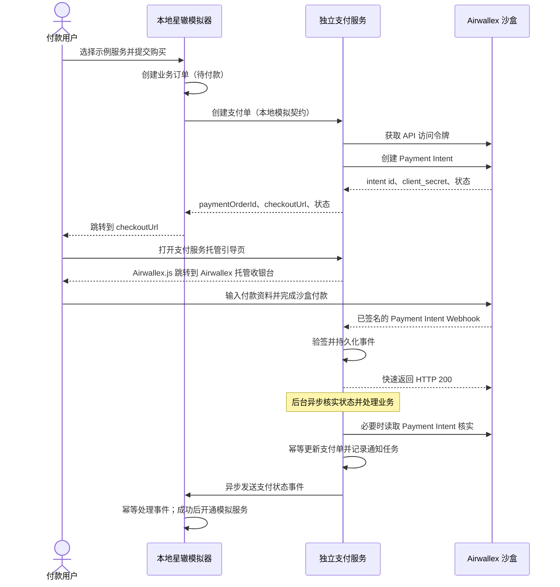

# 本地星辙模拟与 Airwallex 支付链路设计

## 文档状态

- 状态：设计与实施方向已确认；支付纵向链路实现中
- 适用范围：开发阶段的本地纵向支付链路
- 重要声明：本文定义的是本项目的本地模拟契约，不是星辙真实接口。真实接口、签名和状态映射取得星辙资料后另行适配。
- 官方资料核对日期：2026-10-09

## 1. 目标与设计边界

在没有星辙正式接口文档的情况下，提供一个可以真实驱动本地业务订单、支付请求、Airwallex 沙盒收款和结果回传的模拟星辙业务系统。它应让开发者能从“用户购买服务”完整走到“星辙收到已核实结果并更新业务订单”，而不是只返回固定成功状态的假支付。

本项目仍是支付通道工具：星辙模拟器拥有商品/服务、业务订单、退款审批和服务开通；支付服务拥有支付订单、Airwallex 通信、结果核实、通知重试、退款指令执行和支付侧留痕。Airwallex 沙盒负责实际模拟支付体验。此链路不代表生产账户已获批，也不把本地模拟字段当成星辙的正式字段。

### 目标交付

1. 本地模拟星辙用户流程：选择示例服务并创建业务订单。
2. 模拟星辙通过 HTTP 契约提交订单，支付服务创建内部支付单和 Airwallex Payment Intent。
3. 用户从支付服务的付款引导地址进入 Airwallex 托管收银台。
4. 支付服务通过 Airwallex 通知和服务端查询核实状态，再异步通知模拟星辙。
5. 模拟星辙仅在收到可信支付成功通知后将业务订单标为已付款并开通示例服务。
6. 所有模拟器入口、模拟密钥和沙盒配置都限制在本地开发配置中，生产配置启动时拒绝启用模拟器。

### 本次不实现

- 星辙真实生产接口、正式密钥或生产环境部署。
- 生产运营后台、员工账号和只读所有者账号。
- 星辙业务规则本身、真实商品、真实服务开通和退款审批。
- 本地伪造 Airwallex 成功结果或绕过沙盒的付款按钮。
- 订阅、多服务商路由、自建统一支付表单、结算报表和完整运营对账。

## 2. 方案选择

### 采用：本地星辙模拟器 + 真实 Airwallex 沙盒

模拟星辙负责业务订单和业务状态，支付服务仍通过真实 Airwallex 沙盒接口创建 Payment Intent，并使用 Airwallex 官方托管收银台。这样可以验证服务之间的订单契约、幂等、异步通知及托管付款页面。

### 不采用：模拟 Airwallex 返回成功

它无法证明 Payment Intent、托管收银台、Webhook 验签和沙盒账户配置确实可用，也容易把模拟结果误当成真实链路验收。

### 不采用：由浏览器直接调用 Airwallex 服务端接口

Airwallex API 凭据必须留在服务端。浏览器只加载官方 Airwallex.js，并使用 Payment Intent 的 `client_secret` 进入托管收银台；项目自身的 API Key、Client ID 和 Webhook secret 不进入浏览器。

## 3. 系统与调用链



付款完成后用户返回的浏览器页面只展示“处理中/已收到结果”等状态；它不更新支付真相，也不直接开通服务。模拟星辙的业务订单只有在支付服务完成服务端核实并发送成功事件后才变为已付款。

## 4. 本地模拟星辙契约

本契约只为本地开发联调服务，字段采用 JSON camelCase；真实星辙接入时应新增适配器，将真实字段映射到内部命令，不直接改写 Airwallex 领域模型。

### 4.1 创建支付单

`POST /api/v1/integration/payment-orders`

请求示例：

```json
{
  "requestId": "50d86ae3-0ccf-4c89-a26a-d5c81625be10",
  "businessOrderId": "XZ-DEV-20261009-000001",
  "amount": "128.00",
  "currency": "CNY"
}
```

字段规则：

| 字段 | 类型 | 规则 |
| --- | --- | --- |
| `requestId` | 字符串 | 每次新建支付意图生成的唯一 UUID；重试原请求必须复用。 |
| `businessOrderId` | 字符串 | 模拟星辙生成的业务订单号；不得由支付服务覆盖。 |
| `amount` | 十进制字符串 | 大于零，最多两位小数；不使用浮点数传金额。 |
| `currency` | 字符串 | 首期仅接受 `CNY` 或 `USD`；是否能在生产使用取决于商户账户配置。 |

支付方式不由本地模拟星辙在首期选择。当前只有 Airwallex 一个服务商，用户在 Airwallex 托管收银台看到该账户和币种实际可用的付款方式。以后接入多个服务商时，再扩展服务商选择和路由字段。

成功响应示例：

```json
{
  "paymentOrderId": "pay_01J9DEV6Q8W2A3B4C5D6E7F8G9",
  "businessOrderId": "XZ-DEV-20261009-000001",
  "status": "AWAITING_PAYMENT",
  "checkoutUrl": "http://localhost:8080/checkout/cs_opaque_example",
  "createdAt": "2026-10-09T10:30:00Z"
}
```

`checkoutUrl` 是支付服务生成的短期、不透明付款入口，不包含 Airwallex API 凭据。相同 `requestId` 与相同请求体再次提交时返回同一支付单；同一 `requestId` 携带不同订单、金额或币种时返回冲突错误，不得再创建 Payment Intent。

### 4.2 支付结果通知

支付服务向本地模拟星辙发送：

`POST /mock-xingzhe/api/v1/payment-events`

请求示例：

```json
{
  "eventId": "evt_01J9DEV8Q8W2A3B4C5D6E7F8G9",
  "eventType": "PAYMENT_STATUS_CHANGED",
  "businessOrderId": "XZ-DEV-20261009-000001",
  "paymentOrderId": "pay_01J9DEV6Q8W2A3B4C5D6E7F8G9",
  "status": "SUCCEEDED",
  "amount": "128.00",
  "currency": "CNY",
  "occurredAt": "2026-10-09T10:32:12Z"
}
```

模拟星辙以 `eventId` 去重，以服务端核实后的 `status` 更新业务订单。重复事件返回成功确认但不重复开通服务。非成功状态不会开通服务。通知响应体仅用于确认接收，不反向覆盖支付状态。

### 4.3 本地模拟鉴权

本地 HTTP 契约采用专用模拟共享密钥和 HMAC-SHA256 请求签名，签名输入包含时间戳、随机请求标识和原始请求体；服务端拒绝超出短时间窗口的请求并防止随机请求标识重放。支付结果回调使用独立方向的模拟密钥。密钥只通过本地环境变量注入，不写入源码、浏览器包或 Git。

此方案只用来在本地验证服务间鉴权、验签和重放保护。星辙正式鉴权/签名格式必须由真实接口文档确定，不承诺与本地模拟一致。

### 4.4 退款指令

`POST /api/v1/integration/refunds`

退款由星辙模拟器在自己的业务层完成审批后调用。支付服务只校验指令来源、原支付关系、币种、正金额、累计退款上限和防重，再向 Airwallex 发起退款；这些校验不代表支付服务参与退款审批。

本地契约请求字段：`requestId`、`businessOrderId`、`paymentOrderId`、`amount`、`currency`、`reason`。支付服务返回内部 `refundId` 和 `PROCESSING` 等待状态，最终结果通过 `REFUND_STATUS_CHANGED` 事件异步通知。相同退款 `requestId` 重试必须返回同一退款记录。

## 5. Airwallex 官方接口映射

### 5.1 服务端认证

服务端使用 Client ID 和 API Key 调用 Airwallex Access Token API，缓存返回令牌至过期前并复用；不为每个接口请求重新登录。密钥、访问令牌仅在后端内存/受控服务端配置中使用。

沙盒 API 根地址为 `https://api.sandbox.airwallex.com/api/v1/`；正式环境地址和密钥通过独立配置提供，不能由业务请求参数切换。

### 5.2 创建 Payment Intent

服务端调用 `POST /api/v1/pa/payment_intents/create`。核心映射如下：

| 本地支付服务含义 | Airwallex 字段 | 约束 |
| --- | --- | --- |
| 订单金额 | `amount` | 从十进制金额字符串解析为十进制数，禁止二进制浮点计算。 |
| 币种 | `currency` | 大写 ISO 4217 代码；按星辙订单原值传递。 |
| 星辙业务订单关联号 | `merchant_order_id` | 使用 `businessOrderId`，用于双方和 Airwallex 记录关联。 |
| 创建请求幂等号 | `request_id` | 使用稳定且唯一的请求标识；网络超时重试时不生成新值。 |

响应中的 Airwallex `id` 保存为 `providerPaymentIntentId`；`client_secret` 只用于对应用户的付款引导流程，不能作为 API 密钥或写入日志；响应中的 `status` 先映射到内部支付状态。`client_secret` 不向模拟星辙 API 响应暴露。

### 5.3 Airwallex 托管收银台

支付服务自己的 `/checkout/{opaqueToken}` 页面使用短期、不透明、不可猜测的付款令牌向服务端读取该笔付款的一次性上下文，再加载 Airwallex.js 并调用 `redirectToCheckout`。令牌仅关联单笔 Payment Intent，建议有效期 15 分钟，读取后不因页面刷新而生成新的 Payment Intent。官方参数包括 `intent_id`、`client_secret`、`currency`，并应明确提供适当的 `country_code`。Airwallex `client_secret` 是 SDK 必需的短期付款上下文，允许只在该付款页面临时交给浏览器；它不得写入 URL、浏览器持久存储或日志，也不得与 API Key、Client ID 或 Webhook secret 混淆。服务端密钥绝不进入浏览器。

币种会影响托管收银台显示哪些支付方式；实际可用方式由星辙 Airwallex 账户、地区、币种和账户配置决定，不能因为文档列出某方式就承诺其生产可用。沙盒和生产分别选择官方环境配置。

付款引导令牌的失效与重复打开行为、令牌在数据库中的安全保存形式，以及浏览器返回页路由将在实施计划中细化；任何实现都不得将长效 API 凭据暴露到前端。

### 5.4 Webhook 接收和核实

支付服务接收 Airwallex Payment Intent 事件。处理规则：

1. 使用原始请求体和 Airwallex 签名头，在 JSON 解析前验证签名。
2. 以 Airwallex 事件 `id` 建立唯一约束，重复事件只确认接收，不重复产生副作用。
3. 先持久化事件和处理任务，再快速返回 HTTP 200；业务处理异步执行。
4. 不依赖事件到达顺序；对旧事件或状态跳跃通过 Payment Intent 服务端读取核实当前状态。
5. Airwallex 事件只允许推动状态前进；未知事件和无法映射的状态保留原始审计信息并标记待核查，不擅自当作成功。
6. 以核实后的 Payment Intent 状态驱动星辙通知。浏览器返回、前端参数和模拟器页面行为不是付款凭证。

关注的官方 Payment Intent 事件包含创建、待付款方式、需要客户操作、处理中、待审核、成功、取消和失败等生命周期事件。最终映射以 Airwallex 实际沙盒响应、账户 API 版本及官方文档为准。

### 5.5 退款

星辙退款命令通过本地集成接口进入支付服务。支付服务以内部幂等记录防止重复执行，再调用 Airwallex `POST /api/v1/pa/refunds/create`；核心字段为 `request_id` 和原 Payment Intent 标识，部分退款时带 `amount`。Airwallex 退款结果独立于原支付结果记录，并异步通知星辙。

退款成功的含义、状态和处理时间以 Airwallex 返回/通知为准；退款创建被接受不等于退款已结算。首期产品不由员工后台自行批准或新建退款。

## 6. 内部状态与业务规则

支付单和 Airwallex 原始状态分开保存。建议内部支付状态：

| 内部状态 | 含义 | 对星辙的业务影响 |
| --- | --- | --- |
| `CREATING` | 支付请求正在创建 | 不开通服务 |
| `AWAITING_PAYMENT` | Payment Intent 已建成，等待用户付款/操作 | 不开通服务 |
| `PROCESSING` | Airwallex 状态待核实或处理中 | 不开通服务 |
| `SUCCEEDED` | 服务端已核实 Airwallex 支付成功 | 可通知星辙；星辙决定开通服务 |
| `CANCELLED` | 已取消 | 不开通服务 |
| `FAILED` | 已核实失败 | 不开通服务 |
| `REQUIRES_REVIEW` | 状态未知、需审核或数据冲突 | 暂停自动推进并形成异常 |

退款状态独立使用 `PROCESSING`、`SUCCEEDED`、`FAILED`、`REQUIRES_REVIEW`。通知状态独立记录 `PENDING`、`DELIVERED`、`RETRYING`、`NEEDS_ATTENTION`。支付成功不代表退款成功或资金已结算；本阶段不把结算状态并进付款状态。

付款状态映射初稿：Airwallex `SUCCEEDED` 映射为内部 `SUCCEEDED`；`CANCELLED` 映射为 `CANCELLED`；`PENDING`、`PENDING_REVIEW`、`REQUIRES_CUSTOMER_ACTION`、`REQUIRES_PAYMENT_METHOD` 等非终态继续等待或处理中；`REQUIRES_CAPTURE` 不自动视为已收款；未知/互相冲突状态进入 `REQUIRES_REVIEW`。实现时按当前官方状态字典和沙盒实际样例再核对。

## 7. 可靠性、安全和异常恢复

- **重复创建：** 本地 `requestId` 与 Airwallex `request_id` 建立稳定映射；同请求不同金额/币种/订单号拒绝。
- **支付请求超时：** 不生成新的业务订单或盲目新建 Payment Intent；使用同一幂等请求号重试/查询，暂时无法确认时保留待核实状态。
- **Webhook 重复或乱序：** 事件 ID 去重；保存到达时间和 Airwallex 事件时间；服务端读取当前 Payment Intent 后再更新。
- **星辙通知失败：** 支付结果事务提交后创建可靠通知任务，退避重试并可从后台追踪；本设计阶段不包含运营后台人工操作。
- **支付成功但回调未送达：** 本地模拟星辙订单保留待同步，不自行判失败；通知恢复后幂等开通一次。
- **金额/币种/订单不一致：** 拒绝自动推进并进入待核查；不篡改成预期值。
- **密钥保护：** Airwallex API Key、Client ID、Webhook secret 和本地模拟 HMAC 密钥从服务端环境变量/密钥配置注入；日志遮盖 token、client_secret 和签名。
- **沙盒/正式隔离：** Airwallex 环境由部署配置决定，生产启动校验禁止本地模拟控制器和模拟凭据。不可由普通操作员或浏览器参数切换。
- **数据隐私：** 模拟业务订单只发送付款必需字段；首期不向支付服务传送银行卡信息、密码或无关顾客个人资料。

## 8. 本地模拟器的隔离

- 模拟器使用独立的开发配置文件和显式启用开关；默认生产配置不启用。
- 模拟购买页面、虚构服务和示例数据均标注“本地开发模拟数据，不代表真实星辙业务”。
- 本地 Airwallex 环境必须显式设置为 sandbox；缺少 sandbox 配置时付款创建失败关闭，不回退正式环境。
- 生产构建与配置不暴露模拟订单创建、模拟回调、模拟服务开通等路由。
- `.env` 等本地密钥文件不得提交；仓库只提供无真实密钥的变量名示例。

## 9. 尚待真实资料确认

取得星辙接口资料后再确认：

- 正式 API 地址、认证、签名、证书、网络白名单和版本策略。
- 业务订单唯一键、重复提交语义、订单有效期/取消规则及金额单位。
- 回调地址配置、确认响应格式、重试与查询补偿策略。
- 真实用户标识或客户资料是否需要传递，以及最少必要字段。
- 退款审批凭证、部分退款/多次退款规则和退款通知要求。
- Airwallex 商户实体、签约地区、沙盒/正式账户、人民币/美元能力、启用的支付方式和结算安排。
- 星辙业务订单收到付款成功通知后的幂等开通方式。

这些事项影响真实对接，但不阻止先用隔离的本地模拟契约实现开发链路。

## 10. 官方资料

- [Payment Intents 创建接口](https://www.airwallex.com/docs/api/payments/payment_intents/create)
- [Airwallex.js 托管收银台](https://www.airwallex.com/docs/js/payments/hosted-payment-page)
- [API Access Token](https://www.airwallex.com/docs/api/authentication/api_access_token)
- [Payment Intent Webhook 事件](https://www.airwallex.com/docs/payments/reference/payments-webhooks)
- [Webhook 验签、重试与事件交付说明](https://www.airwallex.com/docs/developer-tools/webhooks/webhooks-overview)
- [Refunds 创建接口](https://www.airwallex.com/docs/api/2022-09-09/payments/refunds)
- [退款生命周期说明](https://www.airwallex.com/docs/payments/manage-payments/refunds)
