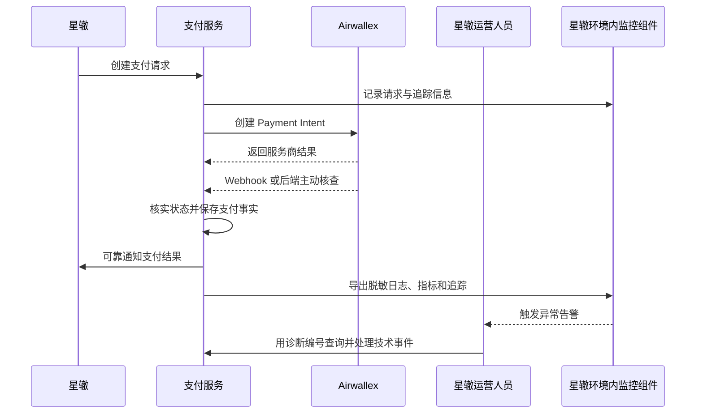

# 支付系统监控与诊断能力设计

## 1. 文档状态

- 状态：设计稿，等待用户审阅。
- 日期：2026-10-10。
- 范围：为支付项目设计前端错误收集、后端日志与请求关联、支付链路追踪、运行指标与告警，以及运营后台诊断入口。
- 数据位置：用户已确认，诊断数据保留在星辙控制的运行环境中。
- 实施约束：本文定义产品能力和组件边界；生产云平台及监控存储产品尚未确定，因此不在本文锁定具体厂商或版本。

## 2. 背景与目标

当前项目已有 Spring Boot Actuator 健康检查、标准化 API 错误响应、支付异常查询、审计记录、支付状态补查和通知重试。它们分别覆盖运行健康或支付业务异常，但还没有把浏览器报错、后端请求、支付处理、Airwallex 通知和星辙结果串成一条可供员工排查的诊断链路。

目标是让用户或员工报错时获得一个诊断编号；员工可以用该编号定位对应页面错误、后端请求和支付流程，并能看到系统健康、延迟、失败和积压告警。监控数据仅用于技术诊断，不是支付、退款或结算的权威账本。

## 3. 产品边界

### 3.1 本期要提供

1. 前端未处理异常、页面崩溃和关键 API 网络/服务端失败的收集。
2. 用户可在错误页面主动补充简短说明，获得可提供给支持人员的诊断编号。
3. 后端为请求和错误生成可关联编号，并输出结构化、脱敏日志。
4. 追踪支付单从星辙请求进入、Airwallex 收款请求创建、Webhook/主动核查、状态持久化到星辙通知的关键步骤。
5. 监控 API 可靠性、支付状态恢复、Webhook、退款核实、通知积压、数据库与运行健康，并按阈值告警。
6. 运营后台增加独立的“技术诊断”入口，按诊断编号、时间、模块、严重程度和处理状态查询事件；允许有权限的员工确认、备注、标记处理完成。
7. 所有诊断操作留审计记录。项目所有者可只读查看；员工诊断操作不能改变支付、退款或结算状态。

### 3.2 明确不做

- 不建设用户行为分析、广告归因、点击热图或逐键采集等通用埋点系统。
- 不将监控事件作为支付成功、退款成功、服务开通或资金到账的判断依据。
- 不把完整 HTTP 请求/响应正文、银行卡信息、认证资料或 Airwallex/星辙密钥放入监控。
- 不在支付项目自行实现一套替代 Airwallex、星辙业务系统或交易账本的状态库。
- 不把诊断平台开放到第三方托管服务；生产运行和诊断数据均由星辙控制。

## 4. 方案取舍

| 方案 | 优点 | 代价 | 结论 |
| --- | --- | --- | --- |
| 在支付项目和交易数据库里自行实现完整日志、指标、追踪与告警平台 | 数据与代码看起来集中 | 需要自行建设检索、保留、聚合、告警和扩容能力；诊断写入会干扰交易数据库 | 不采用 |
| 使用星辙环境内可部署的标准观测组件，支付项目负责采集、脱敏和诊断入口 | 诊断数据留在星辙控制范围；应用与存储解耦；可替换具体存储平台 | 星辙生产部署需要维护监控组件和容量 | 推荐 |
| 使用第三方云监控服务 | 运维工作较少 | 诊断数据离开星辙控制的运行环境 | 不符合已确认的数据存放方向 |

采集格式采用可替换的观测标准。OpenTelemetry 将追踪、指标和日志作为不同信号，并支持由应用生成后交给收集组件处理；Spring Boot Java 有官方自动埋点方案。浏览器侧 OpenTelemetry 追踪仍标注为实验性，因此首期浏览器异常先通过受控的项目 API 上报，暂不把浏览器端追踪 SDK 定为强制依赖。[OpenTelemetry 信号说明](https://opentelemetry.io/docs/concepts/signals/)、[Spring Boot Java 接入说明](https://opentelemetry.io/docs/zero-code/java/spring-boot-starter/)、[浏览器接入状态说明](https://opentelemetry.io/docs/languages/js/getting-started/browser/)

具体日志、指标和追踪存储产品，以及告警消息渠道，等星辙明确生产云平台、资源和支持团队后再选。应用侧不直接绑定单一监控厂商。

## 5. 用户与运营流程

### 5.1 用户/员工遇到页面错误

1. 前端捕获未处理 JavaScript 异常、页面初始化失败、关键请求的网络错误或服务端错误。
2. 前端生成或获取一个不可猜测的诊断编号，并向支付后端发送最小化事件：错误类别、页面路由模板、应用版本、浏览器信息、发生时间及请求编号。
3. 页面显示简短错误说明和诊断编号；用户可选择附加一段文本描述。不上报输入框内容、页面 DOM、截图或浏览器存储。
4. 后端验证大小、频率和字段格式，脱敏后记录诊断事件并转交星辙环境内的观测组件。
5. 员工在运营后台用诊断编号检索事件，查看已授权的请求关联、错误摘要和相关支付单链接，添加处理备注并标记处理进度。

若页面无法访问后端，前端仍显示本地生成的诊断编号供用户提供；不承诺离线事件一定自动补传。

### 5.2 支付链路诊断

关联标识包括支付项目生成的请求编号、诊断编号、内部支付单编号、服务商对象编号、Webhook 事件编号和星辙通知事件编号。可跨系统传递的追踪上下文只用于技术关联，不代替各方签名、幂等键和业务编号。

实际支付状态仍由 Airwallex 通知验签或服务端主动核查后写入交易记录；星辙是否收到通知、是否开通服务，仍分别以星辙响应和星辙业务记录核对。监控平台不可写入上述业务状态。

## 6. 组件职责与数据

### 6.1 前端采集层

- 为 React 应用提供统一错误边界和全局异常处理。
- 仅上报未处理异常、关键请求失败和用户主动提交的错误说明；普通表单校验和预期的业务拒绝不作为系统故障告警。
- 隐去 URL 查询参数和片段；仅记录路由模板，不记录付款令牌、订单详情页完整地址或输入内容。
- 生产构建使用匹配版本的私有 Source Map 还原堆栈；Source Map 不对公网开放。
- 错误消息界面展示诊断编号和重试/返回提示，不展示内部堆栈、SQL、主机名或密钥配置。

### 6.2 后端诊断基础设施

- 统一生成/校验请求关联编号，并把它返回给前端、写入结构化日志和错误响应。
- 未处理异常记录异常类别、堆栈、路由模板、HTTP 状态和关联编号；对用户返回通用错误与诊断编号，不返回堆栈。
- 保留现有 API 错误业务码；增加关联编号不改变支付接口业务语义。
- 通过观测适配层向本地/生产配置的收集器导出数据；收集器不可用不得阻断支付、Webhook 或退款业务。

### 6.3 支付专用指标

- API 请求量、错误率、延迟分位和服务可用状态。
- Airwallex Payment Intent 创建错误、Webhook 验签失败/处理失败、状态主动核查失败及长期待核实数量。
- 星辙支付结果通知失败次数、重试次数、最早未送达时间和积压量。
- 退款结果未知/核查失败/待人工确认数量；不把待人工确认自动视作故障或执行退款。
- 对账差异数量、数据库连接池和容量、任务调度运行状态。

指标标签只使用有限集合，例如模块、错误类别、HTTP 状态、支付商和环境；不得将支付单号、业务订单号、用户标识等高基数字段用作指标标签。需要查单时使用诊断事件或追踪详情。

### 6.4 诊断事件与留存

诊断事件是可搜索、可处理的技术问题摘要，不是原始日志仓库。建议记录：诊断编号、时间、环境、版本、事件类别、严重程度、模块、请求/追踪编号、内部支付单关联（可空）、脱敏错误摘要、处理状态、处理人、处理备注和处理时间。

原始日志和追踪保存在星辙环境内的监控存储；事件摘要可保存在支付项目数据库中。二者分开配置保留期限和访问权限。保留天数、备份和删除周期由星辙生产环境及数据政策确定，不在设计阶段虚构具体期限。

## 7. 隐私、安全与权限

以下内容禁止采集或写入日志、追踪属性、错误上报正文及告警消息：

- Airwallex API Key、Client ID、Webhook secret、星辙签名密钥及任何认证头/cookie/session token。
- 银行卡号、安全码、付款人提交的账单资料或 Airwallex 托管页面内容。
- 完整支付请求/响应体、Webhook 原文、完整 URL 查询参数、密码、邀请链接和临时账号密码。

- 用户输入的自由文本以外的表单字段；自由文本需长度限制、HTML 转义及基本敏感信息过滤，且访问受限。

当前追踪实现对服务端和客户端 HTTP observation 禁止导出原始 `http.url`；服务端只保留路由模板，客户端仅保留固定白名单路由。异常事件使用固定安全消息和无堆栈、无原始原因的异常，仅以固定类别标签区分；不得依赖默认 tracing handler 将原始 `RestClient` 异常写进 span。指标由 Prometheus 拉取，OTLP 指标主动导出关闭。部署环境仍须抽查实际跨度属性与异常事件。

内部支付单编号仅在受控诊断详情中按角色展示；业务订单编号和服务商编号不作为公开诊断编号，也不作指标维度。公共错误响应只提供随机诊断编号，不泄露内部对象编号。

诊断查询沿用运营账号认证。普通员工和员工管理员可查看诊断并处理技术事件；处理操作必须审计。只读所有者只能查询。任何角色都不能通过诊断页修改支付成功、退款成功、结算到账或星辙服务状态。

客户端事件入口需要限制请求体大小、请求频率和允许字段；拒绝任意日志文本、任意标签和任意堆栈长度，避免被滥用造成存储耗尽或敏感数据注入。

## 8. 错误处理与恢复

- 观测收集器或监控存储暂时不可用时，支付核心继续运行；应用按有界缓冲/丢弃低优先级诊断事件，不能无限堆积或阻塞线程。
- 前端错误上报失败时，页面保留诊断编号并允许用户复制；错误上报接口不可影响支付状态或付款返回。
- Webhook 仍快速完成验签和事件接收，后续处理及监控导出与关键业务事务隔离；监控故障不能导致 Webhook 被拒或重复执行支付操作。
- 指标告警不能直接重试支付、批准退款、手工更新交易状态或向星辙伪造结果；只通知责任人并提供受权限保护的排查入口。
- 采样或限流只可用于重复技术噪声；支付差异、退款未知、Webhook 处理失败和通知积压等关键业务诊断不得被静默采样丢弃。

## 9. 部署和分阶段实施

本设计拆分为以下实施阶段，先建立关联和隐私底座，再接入采集和后台，最后根据星辙生产资源部署监控存储及告警：

1. **关联编号与脱敏日志**：统一 request/support ID、标准错误响应关联字段、结构化日志字段及脱敏规则。
2. **前端错误收集**：React 错误边界、全局异常与关键 API 失败采集，用户可复制编号并附加文字说明。
3. **支付链路追踪**：后端自动追踪和少量关键业务 span，贯通支付创建、Webhook/主动核查、通知及退款核实；不将浏览器 SDK 实验能力设为前置条件。
4. **指标与告警**：纳入支付专用指标，定义分级阈值、静默/恢复条件和责任人；告警内容只含诊断编号与受保护页面链接。
5. **运营后台诊断入口**：搜索、详情、关联交易跳转、确认/备注/完成和只读所有者视图；与现有业务“异常事项”菜单区分。
6. **生产部署**：在星辙控制的云环境部署收集器和已选定的日志、指标、追踪存储；配置访问权限、留存、备份和恢复；接入星辙确认的告警渠道。

本地使用隔离配置，不向生产监控发送模拟支付、虚构用户说明或沙盒密钥。生产环境不部署模拟星辙功能。监控服务的故障、容量和升级责任需纳入星辙生产运维分工。

## 10. 验收结果

- 用户报告一个页面/API 错误后，支持人员可用诊断编号找到脱敏事件和后端请求上下文。
- 任意一笔支付可按受权限保护的内部支付单关联，查到创建、Airwallex 通知/核查、支付持久化和星辙通知的时间顺序；未知或缺失步骤清晰显示。
- 通知积压、状态核查失败、退款未知、Webhook 异常及服务 5xx/高延迟可触发配置的告警；恢复后能够确认告警已解除。
- 任意诊断操作均有操作者、时间、对象和动作记录；只读所有者无法处理事件。
- 错误上报和监控导出失败不改变用户付款结果，也不改变支付、退款和结算状态。
- 验收抽查日志、追踪、诊断详情、告警和前端请求，确认不存在上文列出的敏感数据。

## 11. 待部署阶段确认

- 星辙生产云平台、网络边界和是否允许新增容器/服务。
- 监控组件的产品与容量、部署和升级负责人。
- 诊断数据保留期限、备份和删除策略。
- 告警接收渠道、值班对象、分级阈值和响应时限。
- 运营后台哪些具体员工角色可看自由文本报告或完整堆栈。

这些事项不阻止应用先按可替换接口实现关联编号、脱敏采集和业务指标，但在正式生产告警开放前必须定案。
