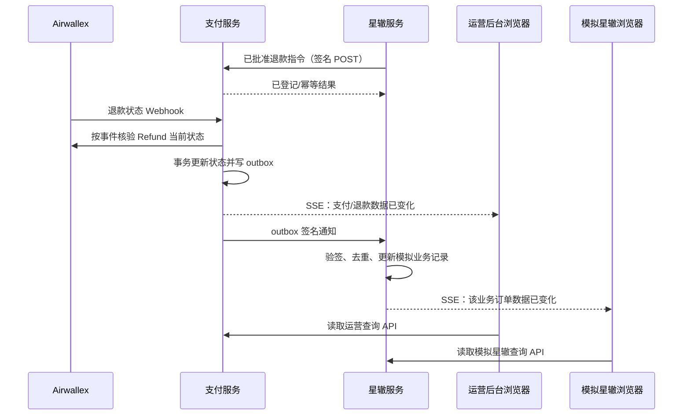

# 退款 Webhook、星辙状态通知与浏览器推送设计

## 目标与当前事实

Airwallex 退款 Webhook 到达后，支付服务核验当前 Refund，更新自己的退款状态，再通过已签名的服务器请求通知星辙。运营后台及本地模拟星辙页面使用服务器发送事件（SSE）感知数据变化，再读取各自已有的受权查询接口；不用浏览器定时轮询。

2026-10-12 本地运行证据：

- 模拟星辙已批准并发送退款指令，支付服务接口返回 HTTP 202。
- Airwallex `refund.received`、`refund.accepted`、`refund.settled` 事件均已收到并处理。
- 本次 `refund.accepted` 在 10:04:34 到达、10:04:37 处理；`refund.settled` 在 10:04:59 到达、10:05:04 处理。
- 星辙通知 outbox 对应记录为 `DELIVERED`，模拟星辙数据库在 10:04:37、10:05:04 保存了阶段事件；人工 Airwallex 核实记录时间为 10:05:05。
- 因此这次服务端状态由 Webhook 推进，手动核实不是前置条件。页面之所以需手动刷新，是因为没有浏览器推送通道。

## 责任边界

- 用户退款申请与星辙业务审批留在星辙系统。只有业务批准后，星辙服务端才向支付服务发送退款指令。
- 支付服务通过 `POST /api/v1/integration/refunds` 即时接收指令；稳定的 `refundRequestId` 用于幂等重试。
- Airwallex 通过 Webhook 通知支付服务退款状态变化；事件消费者核验当前 Airwallex Refund 并更新内部状态。
- 支付服务通过 `notification_outbox` 向星辙服务发送签名退款状态事件。HTTP 2xx 表示星辙服务端已接收该事件，不代表浏览器已刷新。
- SSE 只把不含交易详情的“数据有变化”信号推送给已登录运营后台和本地模拟星辙浏览器。浏览器再以现有 API 读取授权范围内的最新数据。

## 方案取舍

1. 页面定时查询会持续产生请求；当前用户已明确要求关闭。
2. WebSocket 支持双向通信；当前只需服务器向浏览器发信号，使用它增加了不必要的连接协议与状态管理。
3. SSE 是单向服务器推送，浏览器原生自动重连，足以处理本地管理页和模拟器的状态变化，且不需新增依赖，因此采用 SSE。

## 数据流

SSE 通知必须在数据库事务提交后发送，避免浏览器收到信号后重读仍看到旧数据。事件只含可识别的变更类型与必要的业务订单关联键，不广播完整状态快照、金额、付款人信息或签名材料。客户端收到事件后只使相关的活动查询失效并重新读取。

连接初次建立或自动重连后，客户端立即重新读取当前页面数据，以弥补断线期间错过的瞬时事件。SSE 断线不会改变服务端状态或阻止星辙 outbox 投递；页面仍保留手动刷新入口。支付/退款状态调度器和前端定时刷新保持关闭。

## 安全、可用性与边界

- 运营 SSE 端点必须沿用员工会话认证；浏览器 EventSource 使用同源会话 Cookie。
- 模拟星辙 SSE 仅在 `local` profile 装配，并按业务订单订阅；不暴露给生产。
- SSE 发送非敏感变更提示，具体内容仍由现有权限控制 API 提供。
- SSE 断线由浏览器自动重连；重连时重新读取当前数据。手动刷新作为低频兜底。
- 当前应用为本地单进程配置，进程内连接注册表满足此联调。未来若生产多实例部署，需要 Redis Pub/Sub 或等效广播层，确保状态更新所在实例能通知持有浏览器连接的实例。
- Airwallex Webhook 和签名星辙通知仍有持久化去重、队列处理与失败重试；SSE 不替代它们，也不直接决定退款状态。

## 验收边界

- 本地验证：支付服务收到 Airwallex Webhook 后状态推进、星辙服务端收到签名通知、打开的两个前端页面通过 SSE 重新读取；不启用定时交易状态查询。
- 不能据本地模拟推断真实星辙已实现相同接口或已具备浏览器推送；真实星辙接口仍需双方确认。
- `ACCEPTED`、`SETTLED` 均不能证明用户银行账户已显示入账；退款业务结果与渠道结算阶段继续分开记录。
